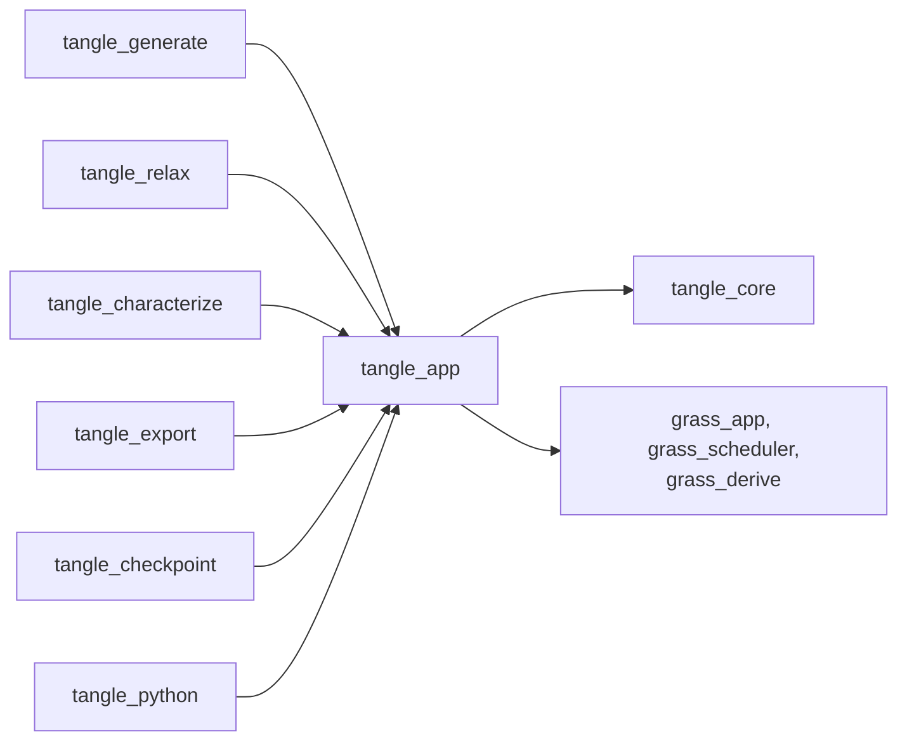
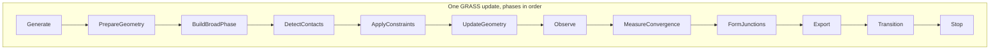

# tangle_app

GRASS workflow orchestration for TANGLE: the stage machine, the ordered phases systems run in, the capability names plugins declare, and the plugins that install the shared `FiberAssembly`. It holds no science. Generation, relaxation, characterization, export and checkpointing crates use it to plug their ordinary functions into one shared workflow, and the Python bindings use it to start a run.

Part of [TANGLE](../../README.md). See [the architecture](../../docs/architecture.md) for how the crates fit together.

## Contents

- [Where it fits](#where-it-fits)
- [What is in it](#what-is-in-it)
- [How it works](#how-it-works)
- [Using it](#using-it)
- [Tests](#tests)

## Where it fits



- [tangle_core](../tangle_core/README.md) gives it `FiberAssembly` and `PeriodicCell`, which its assembly plugins install as a resource.
- GRASS (`grass_app`, `grass_scheduler`, `grass_derive`, pinned by git revision in the workspace `Cargo.toml`) gives it `App`, `Plugin`, `StatesPlugin`, `CapabilityId`, the `ScheduleSet` derive and the run conditions.
- [tangle_generate](../tangle_generate/README.md) adds generator systems in `TanglePhase::Generate` and formation systems in `BuildBroadPhase`, and moves the stage from `Generate` to `Relax`.
- [tangle_relax](../tangle_relax/README.md) adds the GPU relaxation systems in `PrepareGeometry` and `ApplyConstraints` while in `Relax`, then moves to its configured next stage (`Export` by default) on convergence or to `Done` otherwise.
- [tangle_characterize](../tangle_characterize/README.md) observes the assembly in `Generate` and again in `Export`.
- [tangle_export](../tangle_export/README.md) writes trajectories in `Observe` and bonded-particle files in `Export`, then moves to `Done`.
- [tangle_checkpoint](../tangle_checkpoint/README.md) saves restarts in `Observe` while in `Relax`, and on resume sets the stage itself.
- [tangle_python](../tangle_python/README.md) builds an app in [recipe.rs](../tangle_python/src/recipe.rs) with `TangleWorkflowPlugin { initial: TangleStage::Relax }` and `TanglePreparedAssemblyPlugin`.

## What is in it

About 270 lines, tests included.

| Module | What it does |
| --- | --- |
| [lib.rs](src/lib.rs) | `TangleStage`, `TanglePhase`, `TangleWorkflowPlugin`, `TangleAssemblyPlugin`, `TanglePreparedAssemblyPlugin`, the `TANGLE_*` capability ids, and `prelude` |

## How it works

### Stages and phases

The crate defines two separate orderings.

`TangleStage` is the coarse state of the run. It selects which systems are active. Systems are added with `.run_if(in_state(TangleStage::X))`, so a generator runs only in `Generate` and the relaxation batch only in `Relax`. A system moves the run on by setting `NextState<TangleStage>`. A stage can last one update (a generator sets `Relax` at once) or many (relaxation stays in `Relax` until it converges).

`TanglePhase` orders the systems inside one GRASS update. Every update runs the phases in the order they are declared, and only the systems whose stage condition holds do any work. The `ScheduleSet` derive gives each variant its index (`to_index`) and its name (`name`).



Pending stage changes are applied in `TanglePhase::Transition`, near the end of the update, so every system in one update sees the same stage. In `Stop`, `finish_when_done` ends the GRASS loop once the stage is `Done`.

### The stages

`TangleStage::Generate` is the default.

| Stage | Meaning |
| --- | --- |
| `Generate` | create intrinsic fibers and their initial placement |
| `Relax` | detect and resolve invalid overlaps, over many updates |
| `FormJunctions` | turn selected final contacts into persistent junctions |
| `Characterize` | measure the completed assembly |
| `Ready` | hold a prepared assembly for a configured downstream action |
| `Deform` | apply a mechanical loading or deformation process |
| `Export` | write or hand off a derived representation |
| `Done` | end the application loop |

### The phases

| Index | Phase | Meaning |
| --- | --- | --- |
| 0 | `Generate` | generate or import fibers |
| 1 | `PrepareGeometry` | rebuild segment geometry derived from the assembly |
| 2 | `BuildBroadPhase` | build a spatial broad-phase index |
| 3 | `DetectContacts` | produce exact geometric contact data |
| 4 | `ApplyConstraints` | apply one relaxation or mechanics iteration |
| 5 | `UpdateGeometry` | commit solver results to placed geometry |
| 6 | `Observe` | observe the current geometry for diagnostics or trajectory output |
| 7 | `MeasureConvergence` | measure residuals and request stage transitions |
| 8 | `FormJunctions` | create persistent junctions from selected contacts |
| 9 | `Export` | export or hand off the assembly |
| 10 | `Transition` | apply pending stage transitions |
| 11 | `Stop` | stop the application after entering `Done` |

Not every stage and phase has a system yet. In the crates on this branch, no plugin adds systems in `DetectContacts`, `UpdateGeometry`, `MeasureConvergence` or `FormJunctions`, and no plugin enters `FormJunctions`, `Characterize`, `Ready` or `Deform`. The GPU relaxation batch does its contact detection, constraint projection and convergence check inside its `ApplyConstraints` system.

### The plugin contract

A TANGLE plugin is a GRASS `Plugin`. In `build` it adds resources and systems, each system tied to a stage with `run_if(in_state(...))` and to a phase. It declares what it offers and needs with capability ids:

| Capability | Id | Provided by |
| --- | --- | --- |
| `TANGLE_WORKFLOW` | `tangle.workflow` | `TangleWorkflowPlugin` |
| `TANGLE_ASSEMBLY` | `tangle.assembly` | `TangleAssemblyPlugin`, `TanglePreparedAssemblyPlugin` |
| `TANGLE_GENERATION` | `tangle.generation` | the generator plugins in tangle_generate |
| `TANGLE_CONTACTS` | `tangle.contacts` | `RelaxationPlugin` in tangle_relax |
| `TANGLE_RELAXATION` | `tangle.relaxation` | `RelaxationPlugin` in tangle_relax |
| `TANGLE_JUNCTIONS` | `tangle.junctions` | `FormationRecipePlugin` in tangle_generate |
| `TANGLE_FORMATION` | `tangle.formation` | `FormationRecipePlugin`, `LayeredFormationPlugin` in tangle_generate |
| `TANGLE_EXPORT` | `tangle.export` | `BpmExportPlugin` in tangle_export |
| `TANGLE_DEBUG_OUTPUT` | `tangle.debug_output` | `OvitoTrajectoryPlugin` in tangle_export |
| `TANGLE_CHARACTERIZATION` | `tangle.characterization` | `AssemblyCharacterizationPlugin` in tangle_characterize |

Most plugins require `TANGLE_WORKFLOW` and `TANGLE_ASSEMBLY`; `CheckpointPlugin`, for example, also requires `TANGLE_RELAXATION`. Plugins share data through resources: the `FiberAssembly` resource is the canonical geometry, and anything else (contact lists, GPU buffers, reports) is a resource owned by the plugin that makes it.

`TangleWorkflowPlugin` installs `StatesPlugin::new(initial, TanglePhase::Transition)` and the stop system. It reports the phase names through `schedule_labels` and names `TangleStage`, `TanglePhase` and the `FiberAssembly` resource as its `extension_points`. `TangleAssemblyPlugin` installs an empty assembly in a given cell, for generator plugins to fill. `TanglePreparedAssemblyPlugin` installs a fully built assembly, which is how the Python bindings hand over the fibers they staged.

### Invariants

- **Phase order is declaration order.** The derived index follows the order of the `TanglePhase` variants, and the test pins some of them. Adding or moving a variant changes when every later phase runs.
- **Keep `schedule_labels` in step.** `TangleWorkflowPlugin::schedule_labels` lists the phase names by hand. A new phase needs a new entry there, in the same place.
- **Transitions happen in `Transition`.** Systems request a stage with `NextState`; they do not change `CurrentState` during an update. Only `tangle_checkpoint` sets `CurrentState` directly, at build time, when it resumes.
- **`Done` ends the run.** `finish_when_done` is what ends the GRASS loop, and it does so only in `TangleStage::Done`. Every path through a workflow, including failure, must set `Done` in the end.
- **One assembly resource.** Both assembly plugins add the same `FiberAssembly` resource, so a later one replaces an earlier one. Install one of them.

## Using it

The shape of a run, as in [examples/fibers_through_center_point](../../examples/fibers_through_center_point/src/main.rs):

```rust
use grass_app::prelude::*;
use tangle_app::prelude::*;
use tangle_core::PeriodicCell;

let mut app = App::new();
app.add_plugins(TangleWorkflowPlugin::default())
    .add_plugins(TangleAssemblyPlugin::new(PeriodicCell::orthorhombic(
        [1.0; 3],
        [false; 3],
    )))
    .add_plugins(PointCrossingGeneratorPlugin { config })      // tangle_generate
    .add_plugins(RelaxationPlugin { config: relaxation })      // tangle_relax
    .add_plugins(BpmExportPlugin { config: export });          // tangle_export
app.start();
```

A plugin of your own adds systems the same way:

```rust
app.add_update_system(
    my_system.run_if(in_state(TangleStage::Relax)),
    TanglePhase::Observe,
);
```

| Entry point | Use |
| --- | --- |
| `TangleWorkflowPlugin { initial }` | install the stage machine, starting at `initial` (`Generate` by default) |
| `TangleAssemblyPlugin::new(cell)` | install an empty `FiberAssembly` for a generator to fill |
| `TanglePreparedAssemblyPlugin { assembly }` | install an assembly that is already built |
| `TangleStage`, `TanglePhase` | when and in what order a system runs |
| `TANGLE_*` | capability ids for `provides_capabilities` and `requires_capabilities` |
| `prelude` | all of the above in one import |

## Tests

```sh
cargo test -p tangle_app
```

| Where | What |
| --- | --- |
| [lib.rs](src/lib.rs) | the derived phase indices and names match declaration order; a full run goes through one generate update, three relax updates, one junction update and one export update, then stops |
