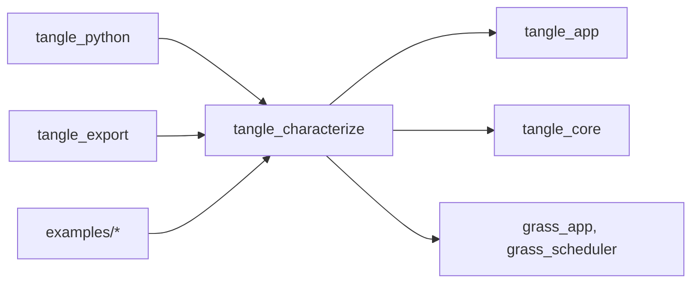
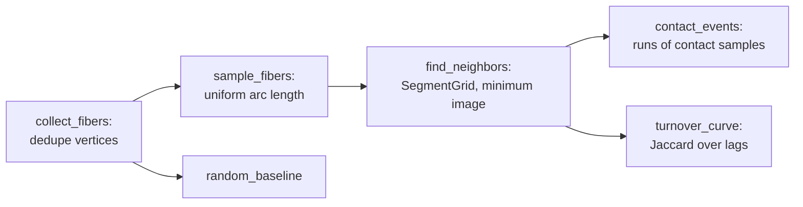

# tangle_characterize

Measures a fiber assembly from its centerlines: volume fraction, orientation tensors, lengths and curvature use (`characterize_assembly`), contacts and neighbors (`analyze_neighbors`), and fiber shape (`analyze_shape`). The measurements use only placed centerlines and section sizes, so the same calls describe a generated structure and centerlines tracked from a CT scan. Python's `characterize`, `characterize_neighbors` and `characterize_shape` call it, and tangle_export puts its report into every PuMA bundle.

Part of [TANGLE](../../README.md). See [the architecture](../../docs/architecture.md) for how the crates fit together, and [PuMA analysis and interoperability](../../docs/puma_interoperability.md) for what each measurement means and how to compare it with PuMA's.

## Contents

- [Where it fits](#where-it-fits)
- [What is in it](#what-is-in-it)
- [How it works](#how-it-works)
- [Using it](#using-it)
- [Tests](#tests)

## Where it fits



- [tangle_core](../tangle_core/README.md) gives it `FiberAssembly`, the section and material tables, bend limits and `maximum_polyline_curvature`.
- [tangle_app](../tangle_app/README.md) gives `AssemblyCharacterizationPlugin` the workflow stages and phases and the `TANGLE_CHARACTERIZATION` capability.
- [tangle_export](../tangle_export/README.md) writes `characterize_assembly`'s result as `tangle_analysis.json` in each PuMA bundle, with `write_analysis_json`.
- [tangle_python](../tangle_python/README.md) wraps the three analyses on `Assembly` ([collection.rs](../tangle_python/src/collection.rs)) and `RunResult` ([recipe.rs](../tangle_python/src/recipe.rs)), and turns the reports into Python objects in [analysis.rs](../tangle_python/src/analysis.rs).
- Some programs under `examples/` (`biased_fiber_box`, `multisegment_flexible_relaxation`, `puma_cross_validation`) depend on it directly.

## What is in it

About 3,100 lines, tests included.

| Module | What it does |
| --- | --- |
| [lib.rs](src/lib.rs) | `characterize_assembly` and its report types `AssemblyMetrics`, `CellMetrics`, `MaterialMetrics`, `FiberMetrics`; `write_analysis_json`, `AnalysisWriteError`, `ANALYSIS_SCHEMA_VERSION`; `AssemblyCharacterizationPlugin` and `AssemblyCharacterizationReport` |
| [neighbors.rs](src/neighbors.rs) | `analyze_neighbors` with `NeighborAnalysisConfig`, `NeighborMetrics`, `FiberNeighborMetrics`, `ContactEvent`, `NeighborAnalysisError`, `NEIGHBOR_SCHEMA_VERSION`; the sampled fiber paths and the segment grid used for the search |
| [shape.rs](src/shape.rs) | `analyze_shape` with `ShapeAnalysisConfig`, `ShapeMetrics`, `FiberShapeMetrics`, `ShapeAnalysisError`, `SHAPE_SCHEMA_VERSION`; the Schladitz orientation fit and the persistence-length fit |
| [distribution.rs](src/distribution.rs) | `Distribution`: count, mean, standard deviation and evenly spaced quantiles of a sample, with `quantile`, `median` and `wasserstein_distance` |

## How it works

### The assembly summary

`characterize_assembly` walks each fiber's placed segments once, skipping zero-length ones. Each segment adds its length to the length-weighted orientation tensor and its nominal volume (section area times length) to the volume-weighted one, for the whole assembly and for its material. The tensors are normalized by total weight, so their trace is one. The volume fraction is nominal: the sum of swept volumes over the cell volume, with overlaps counted twice. `solid_volume_fraction` is an older name for the same number as `nominal_swept_volume_fraction`. Each fiber's largest curvature is divided by its bend limit, when it has one, and fibers over one are counted in `bend_limit_violations`. The function cannot fail and needs no settings.

`AssemblyCharacterizationPlugin` stores a report before relaxation (the first `Generate` frame with fibers, in the `Observe` phase) and after it (in the `Export` stage).

### Contacts and neighbors



Each fiber is sampled at `sample_spacing` (default a quarter of the smallest radius). For each sample the closest point on every other fiber within reach is found through a uniform grid of segments; a segment is registered in every grid cell its expanded bounding box touches, so a query reads one cell. The surface gap is the axis distance minus both radii (an oval counts as its equal-area circle). A gap within `contact_gap` is a contact, within `neighbor_gap` a neighbor, and the pair is in-axis when the crossing angle is under `in_axis_angle` (default 20 degrees). A contact event is a run of consecutive samples on one fiber touching the same other fiber, so each touch is counted once from each side. The report adds the random-placement baseline from the Onsager excluded volume, estimated from `baseline_pairs` random sample pairs with a fixed `seed`, and the neighbor-turnover curve: the mean Jaccard similarity of a fiber's neighbor sets at lags spaced on a log scale.

### Shape

`analyze_shape` resamples every fiber at `sample_spacing` (default the larger of the smallest diameter and the median segment length) and uses the chords as tangents. Curvature is the turning angle per spacing. Torsion is measured only where the curvature on both sides reaches `minimum_torsion_curvature`. It also reports the tangent correlation `C(s)` and its persistence-length fit, the curl index, `|cos θ|` against `orientation_axis`, and the maximum-likelihood Schladitz β with the Wasserstein distance between the data and the fitted model. Distributions are kept as `Distribution` quantile functions, so two structures can be compared with `wasserstein_distance`.

### Invariants

- **Same spacing, comparable numbers.** Shape metrics are measured at the sample spacing, not the stored polyline. The resolved spacing is written in the report; compare two structures only at the same one.
- **Schemas are versioned.** `ANALYSIS_SCHEMA_VERSION`, `NEIGHBOR_SCHEMA_VERSION` and `SHAPE_SCHEMA_VERSION` go into the serialized reports, and the PuMA bundle embeds the assembly report. Bump the version when a field changes meaning or is removed.
- **Keep `solid_volume_fraction`.** It is kept for compatibility and must stay equal to `nominal_swept_volume_fraction`; a test checks the JSON names.
- **Periodic cells must be orthorhombic and large enough.** `analyze_neighbors` rejects a periodic cell with off-diagonal terms, or a periodic axis shorter than twice the search distance, since the minimum image would be ambiguous there.
- **Neighbor gap is at least the contact gap.** The default is twice the largest radius or `contact_gap`, whichever is larger; an explicit smaller value is an error.
- **Results are deterministic.** The baseline uses its own `SplitMix64` seeded from the config, and neighbor lists are sorted by fiber, so the same input gives the same report.

## Using it

```rust
use tangle_characterize::{
    analyze_neighbors, analyze_shape, characterize_assembly, write_analysis_json,
    NeighborAnalysisConfig, ShapeAnalysisConfig,
};

let metrics = characterize_assembly(&assembly);
write_analysis_json(&metrics, "out/tangle_analysis.json")?;

let neighbors = analyze_neighbors(&assembly, &NeighborAnalysisConfig::new(0.5))?;
println!("{} contacts, ratio to random {:?}", neighbors.contacts, neighbors.contact_ratio_to_random);

let shape = analyze_shape(&assembly, &ShapeAnalysisConfig::default())?;
println!("persistence length {:?}", shape.persistence_length);
```

| Entry point | Use |
| --- | --- |
| `characterize_assembly`, `write_analysis_json` | the volume, orientation and curvature summary, and its JSON file |
| `AssemblyCharacterizationPlugin` | before and after summaries inside a GRASS workflow |
| `analyze_neighbors`, `NeighborAnalysisConfig::new(contact_gap)` | contacts, neighbors and turnover |
| `analyze_shape`, `ShapeAnalysisConfig::default()` | curvature, torsion, tangent correlation, curl and orientation |
| `Distribution::wasserstein_distance` | the distance between two reported distributions |

## Tests

```sh
cargo test -p tangle_characterize
```

The crate has no GPU dependencies, so this builds and runs on any machine.

| Where | What |
| --- | --- |
| [lib.rs](src/lib.rs) | orientation tensors are length weighted and sign invariant, volume weighting by diameter, per-material reports, the JSON field names |
| [neighbors.rs](src/neighbors.rs) | crossing and parallel contacts, periodic images, random straight fibers against the baseline, rejected settings, repeated vertices, overlapping contacts, the grid for long diagonal segments |
| [shape.rs](src/shape.rs) | arcs and helices with known curvature and torsion, straight fibers, curl of a right angle, worm-like chain persistence, the Schladitz fit on model and bimodal samples, the default spacing |
| [distribution.rs](src/distribution.rs) | exact quantiles, non-finite values, Wasserstein distance of a shift and between uniform samples |
