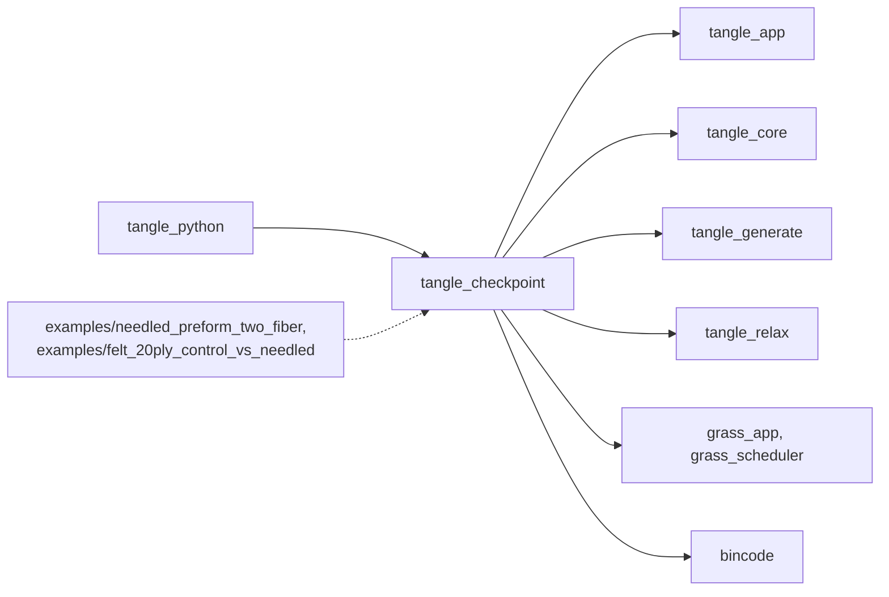
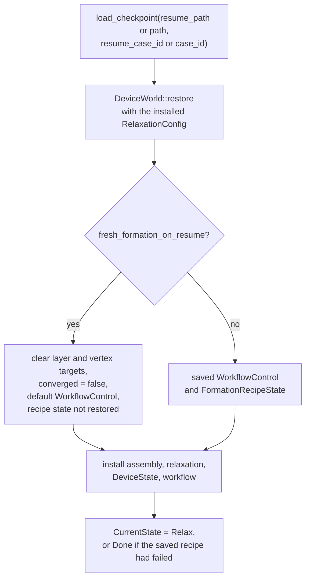

# tangle_checkpoint

Versioned restart files for long TANGLE formation runs. `CheckpointPlugin` saves one rolling checkpoint during relaxation and can restore a run from one at start. A checkpoint holds the `FiberAssembly`, the host-side relaxation and workflow state, the formation recipe's progress, and the persistent part of the GPU world; scratch broad-phase buffers are rebuilt on resume. The Python bindings and the long examples use it.

Part of [TANGLE](../../README.md). See [the architecture](../../docs/architecture.md) for how the crates fit together.

## Contents

- [Where it fits](#where-it-fits)
- [What is in it](#what-is-in-it)
- [How it works](#how-it-works)
- [Using it](#using-it)
- [Tests](#tests)

## Where it fits



- [tangle_core](../tangle_core/README.md) gives it `FiberAssembly`, stored whole in every file.
- [tangle_app](../tangle_app/README.md) gives it `TangleStage`, `TanglePhase` and the capability ids. It saves in `TanglePhase::Observe` while in `TangleStage::Relax`, and requires `TANGLE_WORKFLOW`, `TANGLE_ASSEMBLY` and `TANGLE_RELAXATION`.
- [tangle_relax](../tangle_relax/README.md) gives it `RelaxationConfig`, `RelaxationState`, `WorkflowControl`, `DeviceState`, `DeviceWorld` and `DeviceWorldCheckpoint`. The device world's `checkpoint` and `restore` decide what of the GPU state survives.
- [tangle_generate](../tangle_generate/README.md) gives it `FormationRecipeState`, the recipe's cursor and failure, saved when the recipe plugin is installed.
- [tangle_python](../tangle_python/README.md) maps its `CheckpointSettings` class to `CheckpointConfig` in [checkpoint.rs](../tangle_python/src/checkpoint.rs) and adds `CheckpointPlugin` after the relaxation and recipe plugins in [recipe.rs](../tangle_python/src/recipe.rs).
- Two examples, [needled_preform_two_fiber](../../examples/needled_preform_two_fiber/src/main.rs) and [felt_20ply_control_vs_needled](../../examples/felt_20ply_control_vs_needled/src/main.rs), use it from Rust.

## What is in it

About 520 lines, tests included.

| Module | What it does |
| --- | --- |
| [lib.rs](src/lib.rs) | `CheckpointConfig` and its builders, `CheckpointPlugin`, `CheckpointReport`, `TangleCheckpoint`, `CheckpointError`, `load_checkpoint`, and the private `save_checkpoint`, `encode_checkpoint` and `commit_atomically` |

## How it works

### The file

A checkpoint file is a 12-byte header followed by a bincode payload:

| Bytes | Content |
| --- | --- |
| 0..8 | the magic `TANGLE01` |
| 8..12 | the schema version, a little-endian `u32`, now `4` (`CHECKPOINT_SCHEMA`) |
| 12.. | a bincode `TangleCheckpoint` |

`TangleCheckpoint` has six fields: `case_id`, `assembly` (`FiberAssembly`), `relaxation` (`RelaxationState`), `workflow` (`WorkflowControl`), `formation` (`Option<FormationRecipeState>`) and `device` (`DeviceWorldCheckpoint`: the packed topology with current positions, lifetime iteration count, refinement counts, wall reactions, and any active layer or vertex target).

`load_checkpoint` reads the header first and returns `IncompatibleSchema` before decoding anything if the magic or schema differ. It then decodes the payload and returns `CaseMismatch` if the stored `case_id` is not the one asked for. The case id is how a run refuses a file from a different recipe.

### Saving

`CheckpointPlugin` adds `save_checkpoint` in `TanglePhase::Observe`, run only in `TangleStage::Relax`. Each update it looks at `RelaxationState::iterations` and saves when:

- the iteration is above zero and differs from the last saved one, and
- either the iteration has crossed a multiple of `interval_iterations` since the last save, or the run is at a terminal point: a cell-list overflow, convergence without `hold_relax_stage`, or a formation recipe failure.

Before saving it clears `relaxation.snapshots`, so debug snapshots are not stored. `commit_atomically` writes the bytes to `.<name>.tmp` next to the target, calls `sync_all`, and renames it over the target, so a crash leaves either the old file or the new one. Parent directories are created as needed. Each save updates `CheckpointReport` (`saves`, `last_saved_iteration`, `last_saved_bytes`) and prints one line.

### Resuming

With `resume` set, the plugin restores in `build`, before the schedule starts:



The restored resources replace the ones installed by earlier plugins, and `NextState` is cleared. `last_saved_iteration` is set to the restored iteration, so the plugin does not save the same state again at once. `with_resume_source` restores from another file and case id while new checkpoints still go to `path` under `case_id`.

Errors in a running app are not returned. Loading, encoding or writing failures panic with the `CheckpointError` message. `load_checkpoint` is the one function that returns them, for tools that read a file without running it.

### Invariants

- **Bump the schema when the payload changes.** bincode reads fields by position, with no names. Any change to the fields of `TangleCheckpoint` or of a type inside it, in this crate, [tangle_core](../tangle_core/README.md), [tangle_relax](../tangle_relax/README.md) or [tangle_generate](../tangle_generate/README.md), needs `CHECKPOINT_SCHEMA` raised, or old files decode wrongly or fail as a codec error instead of being refused cleanly.
- **Plugin order.** `CheckpointPlugin` must be added after `RelaxationPlugin`, since resume reads its `RelaxationConfig` resource and panics without it. A checkpoint with formation state also needs `FormationRecipePlugin` installed first (`MissingFormationPlugin` otherwise), unless `fresh_formation_on_resume` is set.
- **Settings are checked at build.** `interval_iterations` must be positive and `case_id` non-empty; both are asserted.
- **Resume enters `Relax`.** A restored run always starts in `TangleStage::Relax`, or `Done` for a failed recipe. Saving only happens in `Relax`.

## Using it

```rust
use tangle_checkpoint::{CheckpointConfig, CheckpointPlugin, CheckpointReport};

app.add_plugins(RelaxationPlugin { config: relaxation })
    .add_plugins(FormationRecipePlugin { config: recipe })
    .add_plugins(CheckpointPlugin {
        config: CheckpointConfig::new("my-case", "out/run.ckpt", 5_000).with_resume(resume),
    });
app.start();

if let Some(report) = app.get_resource_ref::<CheckpointReport>() {
    println!("{} saves, last at {:?}", report.saves, report.last_saved_iteration);
}
```

| Entry point | Use |
| --- | --- |
| `CheckpointConfig::new(case_id, path, interval_iterations)` | save every interval to `path` |
| `.with_resume(true)` | restore from `path` before the run |
| `.with_resume_source(case_id, path)` | restore from another file and case, keep saving to `path` |
| `.with_fresh_formation_on_resume(true)` | keep the restored geometry but start the installed recipe from its first operation |
| `CheckpointPlugin { config }` | install saving and, if asked, resume |
| `CheckpointReport` | the resource that says whether the run resumed and what it saved |
| `load_checkpoint(path, case_id)` | read and check a file without installing it |

From Python, pass a `CheckpointSettings(case_id, path, ...)`, whose fields match `CheckpointConfig`.

## Tests

```sh
cargo test -p tangle_checkpoint
```

| Where | What |
| --- | --- |
| [lib.rs](src/lib.rs) | an atomic write and load keeps relaxation, workflow, device and assembly state; a file from another case is refused; a changed schema number is refused before the payload is decoded |

The tests build a one-fiber assembly and a `DeviceWorldCheckpoint` from `PackedAssembly::from_assembly` on the host, so they need no GPU. They write to the system temporary directory.
