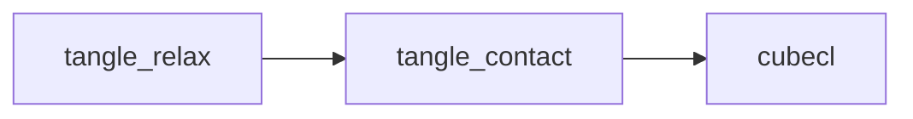

# tangle_contact

The contact side of TANGLE's relaxation: CubeCL kernels that bin fiber segments into a uniform grid, build Verlet neighbor lists from it, find every capsule overlap and turn each into a correction, and capture the contacts present at a checkpoint. The kernels hold no state of their own. [tangle_relax](../tangle_relax/README.md) owns the device buffers, launches the kernels in order and applies the corrections they write; it is the only crate that depends on this one.

Part of [TANGLE](../../README.md). See [the architecture](../../docs/architecture.md) for how the crates fit together, and [Oval fibers](../../docs/oval_fibers.md) for how oval sections are modelled in contact.

## Contents

- [Where it fits](#where-it-fits)
- [What is in it](#what-is-in-it)
- [How it works](#how-it-works)
- [Using it](#using-it)
- [Tests](#tests)

## Where it fits



- [tangle_relax](../tangle_relax/README.md) allocates every buffer these kernels read and write, launches them from `DeviceFiberWorld` ([world/cell_list.rs](../tangle_relax/src/device/world/cell_list.rs), [world/neighbor_list.rs](../tangle_relax/src/device/world/neighbor_list.rs), [world.rs](../tangle_relax/src/device/world.rs)), and re-exports `CellListConfig`. Its image force also calls `proxy_cell` so it locates segments in the grid exactly as contact does.
- `cubecl` is the only dependency. The crate's `wgpu`, `cpu`, `cuda` and `hip` features turn on the matching CubeCL runtime; tangle_relax forwards its own features to them.

## What is in it

About 1,800 lines. There are no tests in the crate; tangle_relax tests the kernels through the device world.

| Module | What it does |
| --- | --- |
| [lib.rs](src/lib.rs) | `CellListConfig`: cell size scale, neighbor skin and neighbor slots per segment, with their defaults (1.0, 2.0 and 48) |
| [device.rs](src/device.rs) | the `device` module (hidden from docs) and the kernels it re-exports |
| [device/cell_list.rs](src/device/cell_list.rs) | the count, scan and scatter grid build: `clear_cell_list`, `count_cell_segments`, `exclusive_scan_cell_blocks`, `add_cell_block_offsets`, `scatter_cell_segments`, `rank_cell_segments`; and the shared helpers `proxy_cell`, `proxy_of` and `along_fiber_gap` |
| [device/neighbor.rs](src/device/neighbor.rs) | Verlet neighbor lists: `gather_cell_slot_geometry`, `build_segment_neighbor_lists`, `sort_neighbor_lists`, `snapshot_neighbor_reference_positions`, and the rebuild flag kernels `request_neighbor_list_rebuild`, `flag_neighbor_list_displacement`, `finish_neighbor_list_rebuild` |
| [device/contact.rs](src/device/contact.rs) | `find_segment_corrections`, the per-segment contact projection, and `capture_segment_contacts`, which lists contacting segment pairs for junction capture |

## How it works

### The grid

Segments are binned by count, scan and scatter, so the grid has no per-cell capacity. `count_cell_segments` counts the pieces in each cell, `exclusive_scan_cell_blocks` and `add_cell_block_offsets` turn the counts into offsets (256-element blocks, scanned again over the block sums), and `scatter_cell_segments` writes each piece into its cell's range with an atomic cursor. The cursor fills a cell in a different order every run, so the scatter writes to scratch slots and `rank_cell_segments` then moves each slot to its rank by (segment, piece) within its cell. Everything downstream sees candidates in the same order on every run, which keeps float sums bitwise repeatable.

A segment longer than one list block is binned as several equal proxy pieces, so the cell size follows the short segments of an adaptive layout rather than its unrefined parents. `proxy_cell` gives the cell of one piece's midpoint; with one piece it is the segment midpoint. Contact capture bins every segment whole (`use_proxies == 0`).

### Neighbor lists

`gather_cell_slot_geometry` copies each slot's endpoints, radius and topology into cell-sorted arrays, so the list build reads each candidate cell as one contiguous range. `build_segment_neighbor_lists` runs one thread per slot and keeps every segment of another fiber, or of the same fiber far enough along it, whose capsule is within the skin of touching. A pair of long segments can meet in several proxy pairs' stencils; only the proxy pair holding the closest points of the two axes records it, so each neighbor is listed once. Several threads append to one segment's list, so `sort_neighbor_lists` sorts it by segment index afterwards.

Each segment has `capacity * list_weights[segment]` slots starting at `capacity * list_offsets[segment]`, so long segments get more room. A segment with more neighbors than its room stores its true count instead. The contact kernel then scans the cells around each of its proxy pieces, located from the positions the lists were built from, so overflow costs speed but never loses a contact.

The rebuild request lives on the device in `neighbor_state` (entry 0 is the pending flag, entry 1 counts rebuilds). Two segments' distance changes by at most twice the largest endpoint move, so a list built with skin `s` holds every contact until some vertex has moved more than `s / 2`. `flag_neighbor_list_displacement` compares positions with the snapshot taken at the last build and sets the flag past that distance; `request_neighbor_list_rebuild` sets it unconditionally. Every build kernel checks the flag and returns at once when it is clear, so the host never reads it back.

### Contact projection

`find_segment_corrections` runs one thread per active segment. For each candidate it first rejects pairs whose midpoints are farther apart than both half lengths plus both radii, then solves for the closest points of the two axes (with an extra end check for nearly parallel segments) under the minimum periodic image. Two segments of one fiber are skipped when `along_fiber_gap`, their rest length apart along the fiber, is below the sum of their radii: they overlap in space only because the fiber is continuous. A fiber looping back onto itself is many diameters apart along it and is kept.

An oval section is a row of two to five round lanes side by side along the vertex directors, and `radius` bounds the whole row. Round fibers have one lane at zero offset, which reduces every lane term to plain capsule contact. Off-centre contacts on an oval also produce a director turn (`director_corrections`), measured in lengths of the section's radius of gyration so turns and shifts share one generalized mass.

Each overlap becomes a correction of both endpoints scaled by `correction_fraction`. `contact_aggregation` chooses how a segment's contacts combine: 0 averages them, 1 weights each by its penetration before averaging, 2 keeps only the deepest. A raw sum would grow with the number of contacts and oscillate in dense networks. The kernel writes six correction values and two turns per segment, plus the segment's largest penetration, which tangle_relax reduces for convergence and adaptive refinement.

`capture_segment_contacts` bins whole segments, scans the 27 cells around each segment's midpoint and records each pair from different fibers within `maximum_surface_gap`, with closest-point coordinates, surface gap and crossing angle.

### Invariants

- **One placement rule.** Every kernel that locates a proxy piece calls `proxy_cell` (and `proxy_of`), including tangle_relax's image force. They must agree bit for bit, or a list build and its overflow scan see different cells.
- **Lists are valid until the flag is set.** The contact pass reads lists and the overflow scan reads `neighbor_reference_positions` without checking how old they are. Anything that moves vertices outside the displacement check, changes the active set or overwrites the grid (contact capture does) must request a rebuild.
- **Deterministic order.** `rank_cell_segments` and `sort_neighbor_lists` exist so float sums run in a fixed order. A new atomic append needs the same treatment, or repeatability tests in tangle_relax fail.
- **Lane counts agree.** The lane count formula in `find_segment_corrections` matches `oval_lane_count` in tangle_relax ([packed.rs](../tangle_relax/src/device/packed.rs)); change both together.
- **Periodic stencils stay unique.** With one or two cells along a periodic axis, neighbor offsets wrap onto the same cell; the kernels drop those duplicates so a pair is not counted twice.
- **The control word gates every pass.** Kernels return when `control[0]` is zero, which is how tangle_relax stops a batch on the device without a readback.

## Using it

The kernels are `launch_unchecked` CubeCL kernels with long buffer lists; call them through tangle_relax rather than directly. The public type a caller sets is `CellListConfig`:

```rust
use tangle_contact::CellListConfig;

let cell_list = CellListConfig {
    neighbor_skin_scale: 1.0,
    ..CellListConfig::default()
};
let config = tangle_relax::RelaxationConfig::flexible().with_cell_list(cell_list);
```

| Entry point | Use |
| --- | --- |
| `CellListConfig` | grid and neighbor-list settings, passed in `RelaxationConfig::cell_list` |
| `device::*` | the kernels, launched by `DeviceFiberWorld` in tangle_relax |

Python sets the same fields through the relaxation settings in [crates/tangle_python/src/settings.rs](../tangle_python/src/settings.rs).

## Tests

The crate has no tests of its own. Its kernels are tested through the device world:

```sh
cargo test -p tangle_relax
```

| Where | What |
| --- | --- |
| [tangle_relax world_tests.rs](../tangle_relax/src/device/world_tests.rs) | neighbor lists against rebuilding every iteration, every pair within the skin is listed, proxy binning and proxy overflow scans, periodic minimum-image and self-image contacts, self-contact along one fiber, oval lanes, bitwise repeatability |
| [tangle_relax world/image_force.rs](../tangle_relax/src/device/world/image_force.rs) | the image force reading weighted neighbor lists |
