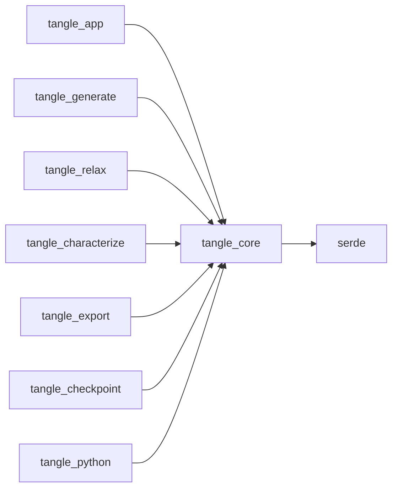

# tangle_core

The shared data model of TANGLE: `FiberAssembly`, a solver-neutral record of which fibers exist, their intrinsic and placed centerlines, their cross-sections and materials, and which material points are joined by persistent junctions. It holds no mechanics, no GPU buffers, no meshes and no voxels; those are derived by other crates. Every crate that builds, relaxes, measures, exports or saves an assembly depends on it, and its only dependency is serde.

Part of [TANGLE](../../README.md). See [the architecture](../../docs/architecture.md) for how the crates fit together, [Oval fibers](../../docs/oval_fibers.md) for elliptical sections and directors, and [Fiber bonds](../../docs/fiber_bonds.md) for what is built on junctions.

## Contents

- [Where it fits](#where-it-fits)
- [What is in it](#what-is-in-it)
- [How it works](#how-it-works)
- [Using it](#using-it)
- [Tests](#tests)

## Where it fits



- [tangle_app](../tangle_app/README.md) installs a `FiberAssembly` as the workflow's shared resource (`TangleAssemblyPlugin`, `TanglePreparedAssemblyPlugin`).
- [tangle_generate](../tangle_generate/README.md) fills an assembly with fibers through `add_fiber`, sets formation steps and layers, and adds junctions.
- [tangle_relax](../tangle_relax/README.md) packs the assembly for the GPU, writes the relaxed positions back into `geometry.placed`, and calls `capture_assembled_reference` after a converged run when asked.
- [tangle_characterize](../tangle_characterize/README.md) and [tangle_export](../tangle_export/README.md) read the assembly to measure it and to write derived files.
- [tangle_checkpoint](../tangle_checkpoint/README.md) stores the whole `FiberAssembly` in each restart file.
- [tangle_python](../tangle_python/README.md) builds assemblies from Python (`collection.rs`) and uses the director helpers directly.

[tangle_contact](../tangle_contact/README.md) and [tangle_ct](../tangle_ct/README.md) do not depend on it.

## What is in it

About 1,700 lines, tests included.

### The assembly

| Module | What it does |
| --- | --- |
| [lib.rs](src/lib.rs) | the public re-exports and `Vec3`, a `[f64; 3]` point or vector |
| [assembly.rs](src/assembly.rs) | `FiberAssembly` and its builders: `new`, `add_fiber`, `add_junction`, `set_fiber_bend_limit`, `set_fiber_directors`, `ensure_directors`, `fiber_directors`, `set_fiber_formation_step`, `set_fiber_formation_layer`, `capture_assembled_reference` |
| [fiber.rs](src/fiber.rs) | `Fiber` (identity, vertex `Span`, material, section, formation layer and step), `FiberTopology`, `GeometryState` (positions and directors) and `FiberGeometry` (intrinsic, placed, optional assembled reference) |
| [cell.rs](src/cell.rs) | `PeriodicCell`: origin, three edge vectors and per-axis periodicity; `orthorhombic` and `signed_volume` |
| [ids.rs](src/ids.rs) | the `u32` newtype ids `FiberId`, `MaterialId`, `SectionId`, `JunctionId`, `JunctionLawId`, `JunctionParameterId`, and `Span`, a range into a flat table |
| [section.rs](src/section.rs) | `Section::Circular` and `Section::Elliptical`, with `is_circular`, `area` and `bounding_radius`; `SectionTable` |
| [material.rs](src/material.rs) | `MaterialDescriptor` (a name only) and `MaterialTable`, which interns names |
| [admissibility.rs](src/admissibility.rs) | `FiberBendLimit` (a minimum bend radius) and `FiberAdmissibility`, one optional limit per fiber |
| [provenance.rs](src/provenance.rs) | `Provenance`: source, version, seed and notes |

### Junctions

| Module | What it does |
| --- | --- |
| [junction.rs](src/junction.rs) | `FiberAnchor`, `ResolvedAnchor`, `Junction`, `JunctionTable`, `JunctionLawDescriptor`, `JunctionLawTable`, and `FiberAssembly::resolve_anchor` |

### Geometry helpers and checks

| Module | What it does |
| --- | --- |
| [director.rs](src/director.rs) | per-vertex long-axis directions for oval sections: `polyline_tangents`, `default_director`, `default_directors`, `project_director`, `orthonormalize_directors` |
| [curvature.rs](src/curvature.rs) | `measure_vertex_curvature`, `VertexCurvature` and `maximum_polyline_curvature` |
| [math.rs](src/math.rs) | crate-private `dot`, `cross`, `sub`, `norm`, `distance` |
| [validation.rs](src/validation.rs) | `FiberAssembly::validate`, `ValidationReport` and `ValidationIssue` |
| [error.rs](src/error.rs) | `BuildError` from the builders and `AnchorError` from `resolve_anchor` |

## How it works

### Flat storage

All fibers share flat arrays. `geometry.intrinsic.positions` and `geometry.placed.positions` hold every vertex of every fiber, and each `Fiber` names its range with a `Span { start, len }`. Junction anchors are stored the same way: `junctions.anchors` is one flat array and each `Junction` points into it with a `Span`. `add_fiber` and `add_junction` append to the end of these arrays, so spans are dense and in order. Ids such as `FiberId` are stable names chosen by the caller; the position in `topology.fibers` is the dense working index, and the two are not the same.

### Three geometry states

`FiberGeometry` keeps three centerline states with the same vertex layout:

- `intrinsic`: the stress-free shape of each fiber on its own. Each fiber may sit in any rigid frame; only lengths and relative directions matter.
- `placed`: the current centerlines in the cell's world frame. Relaxation writes here.
- `assembled_reference`: an optional copy of `placed`, taken by `capture_assembled_reference`, used by later mechanics and export as the stress-free assembled state. Fibers added after the capture are appended to it too.

Fiber coordinates are stored unwrapped, even in a periodic cell.

### Junctions and anchors

A `Junction` joins two or more `FiberAnchor`s. An anchor names a fiber by `FiberId` and a point on it by `rest_arc_length`, measured along the intrinsic centerline, so it stays on the same material point if the polyline is remeshed. `section_offset` optionally places it off the centerline. `resolve_anchor` walks the intrinsic polyline, skips zero-length segments, and returns the dense fiber index, the local segment and the coordinate within it. A length past the end is accepted within a small tolerance (`sqrt(f64::EPSILON)` times the length) and clamped to the last segment.

A junction's behaviour is not stored here. `law` points into `JunctionLawTable`, which holds only names such as `welded`, and `parameters` is a `JunctionParameterId` that a plugin interprets.

### Directors for oval fibers

An elliptical section's first semi-axis lies along a per-vertex director in `GeometryState::directors`. The list is either empty (no fiber needs one) or has one entry per position. `default_director` lays the section flat: it takes the direction perpendicular to the tangent in the xy plane, or x when the tangent is along z. `default_directors` then flips signs so neighbouring directors never point apart. The first call to `set_fiber_directors` fills every fiber with defaults through `ensure_directors`, then projects the given directors perpendicular to the tangent. Once directors exist, `add_fiber` gives each new fiber default ones.

`GeometryState` has its own `Serialize`. JSON leaves out an empty `directors`, so files of round fibers look as they did before ovals. Binary formats such as the bincode checkpoints always write both fields.

### Curvature and bend limits

`measure_vertex_curvature` uses `2 sin(theta / 2) / dual_length`, where theta is the turning angle and the dual length is the mean of the two adjacent segment lengths. This is exact for three samples on a circle with equal chords. A `FiberBendLimit` stores a minimum bend radius, and `validate` checks the intrinsic shape against `1 / minimum_bend_radius`.

### Validation

`validate` collects every problem in one pass and returns them as a `ValidationReport`, each with a stable `code` (for example `fiber.non-dense-span`, `junction.unknown-law`, `anchor.unresolvable`, `fiber.invalid-director`) and a message. It checks structure (array lengths, dense spans, duplicate ids, known materials, sections and laws) and geometry (finite cell with nonzero volume, positive section sizes, finite positions, no zero-length intrinsic or collapsed placed segments, bend limits, resolvable anchors, unit directors perpendicular to the tangent within `1.0e-3` for non-circular fibers).

### Invariants

- **Spans cover the arrays densely.** Each fiber's vertices start where the previous fiber's end, and together they cover all positions; the same holds for junction anchors. Append through `add_fiber` and `add_junction`, or keep this by hand; `validate` reports `fiber.non-dense-span`, `fiber.unclaimed-vertices` and `junction.unclaimed-anchors` otherwise.
- **The states line up.** `intrinsic`, `placed` and any `assembled_reference` have the same number of positions, and `admissibility.bend_limits` has one entry per fiber.
- **Directors are all or nothing.** A state's `directors` is empty or the same length as its `positions`.
- **Names are interned.** `MaterialTable::add` and `JunctionLawTable::add` return the existing id for a name already present. Recipes look laws and materials up by name, so do not push duplicate entries directly.
- **Ids are dense indices into their tables.** `MaterialId`, `SectionId` and `JunctionLawId` index `entries`; `FiberId` and `JunctionId` are not indices and must be unique.
- **Binary layout.** Checkpoints are bincode, which reads fields by position. Adding, removing or reordering a serialized field of any type here changes the checkpoint format (see [tangle_checkpoint](../tangle_checkpoint/README.md)). The custom `GeometryState` serializer must keep writing `directors` for non-human-readable formats.

## Using it

From [examples/crossed_fibers.rs](examples/crossed_fibers.rs):

```rust
use tangle_core::{
    FiberAnchor, FiberAssembly, FiberId, JunctionId, JunctionParameterId, PeriodicCell, Section,
};

let mut assembly = FiberAssembly::new(PeriodicCell::orthorhombic([1.0, 1.0, 1.0], [false; 3]));
let material = assembly.materials.add("carbon fiber");
let section = assembly.sections.add(Section::Circular { radius: 5.0e-6 });
assembly.add_fiber(
    FiberId(10),
    material,
    section,
    &[[-4.0e-4, 0.0, 0.0], [4.0e-4, 0.0, 0.0]],
    &[[0.4996, 0.5, 0.5], [0.5004, 0.5, 0.5]],
)?;
assembly.add_fiber(
    FiberId(20),
    material,
    section,
    &[[0.0, -4.0e-4, 0.0], [0.0, 4.0e-4, 0.0]],
    &[[0.5, 0.4996, 0.5], [0.5, 0.5004, 0.5]],
)?;

let law = assembly.junction_laws.add("welded");
let anchors = [FiberId(10), FiberId(20)].map(|fiber| FiberAnchor {
    fiber,
    rest_arc_length: 4.0e-4,
    section_offset: None,
});
assembly.add_junction(JunctionId(1), law, JunctionParameterId(0), &anchors)?;
assembly.validate()?;
```

| Entry point | Use |
| --- | --- |
| `FiberAssembly::new`, `add_fiber`, `add_junction` | build an assembly |
| `MaterialTable::add`, `SectionTable::add`, `JunctionLawTable::add` | register materials, sections and laws before using their ids |
| `set_fiber_bend_limit`, `set_fiber_formation_step`, `set_fiber_formation_layer` | per-fiber settings, by `FiberId` |
| `set_fiber_directors`, `fiber_directors`, `default_directors` | oval fiber orientation |
| `resolve_anchor` | map a material point to a segment of the current polyline |
| `validate` | check an assembly before handing it on |
| `measure_vertex_curvature`, `maximum_polyline_curvature` | discrete curvature of a polyline |

Python reaches the assembly through the `Cell`, `Material`, `FiberCollection` and `Assembly` classes in [tangle_python's collection.rs](../tangle_python/src/collection.rs).

## Tests

```sh
cargo test -p tangle_core
cargo run -p tangle_core --example crossed_fibers
```

| Where | What |
| --- | --- |
| [assembly.rs](src/assembly.rs) | junctions with more than two fibers; the assembled reference is an independent copy |
| [junction.rs](src/junction.rs) | law names are interned; anchors resolve across uneven segments; an anchor past the end is refused |
| [validation.rs](src/validation.rs) | a valid assembly passes; oval directors must be perpendicular unit vectors; fibers added later get default directors; assemblies without directors serialize to JSON as before |
| [director.rs](src/director.rs) | default directors lie flat, fall back to x, do not flip along a bend; projection removes the tangent part |
| [curvature.rs](src/curvature.rs) | a straight vertex has zero curvature; circle samples give the exact curvature at two refinements |
| [material.rs](src/material.rs) | material names are interned |
| [examples/crossed_fibers.rs](examples/crossed_fibers.rs) | two crossed fibers joined by one welded junction, validated and resolved |
