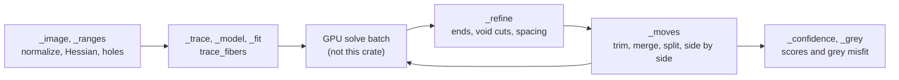

# tangle_ct

The volume kernels behind `tangle.ct`, the Python fitter that places Tangle fibers in a CT scan. It filters and samples volumes, takes distance transforms and Hessians, traces initial centerlines, draws fitted fibers back into voxels, and runs the topology moves and confidence scores between solver batches. It also holds the parallel-beam projector that makes synthetic scans. The only user is [tangle_python](../tangle_python/README.md), whose `_native.py` wraps each kernel for the Python steps.

Part of [TANGLE](../../README.md). See [the architecture](../../docs/architecture.md) for how the crates fit together. The fitter itself is described in [Fitting Tangle fibers to CT scans](../../docs/ct_fitting.md) (the user guide) and [How `tangle.ct` fits fibers, step by step](../../docs/ct_fitting_internals.md) (each step with its file and function). [Synthetic CT scans](../../docs/ct_synthetic.md) covers the scans the projector here makes, and [CT map network](../../docs/ct_unet.md) the second route, a 3D U-Net, which does not call this crate.

## Contents

- [Where it fits](#where-it-fits)
- [What is in it](#what-is-in-it)
- [How it works](#how-it-works)
- [Using it](#using-it)
- [Tests](#tests)

## Where it fits


- [tangle_python](../tangle_python/README.md) is the only crate that depends on it. [src/ct.rs](../tangle_python/src/ct.rs) exposes each kernel as a `ct_*` function (and the `CtHessian` class) of `tangle._tangle`. Volumes arrive as NumPy arrays through the buffer protocol without copies, polylines arrive packed as one `(n, 3)` node array plus per-fiber node counts, and results are written into arrays the caller allocates. [python/tangle/ct/_native.py](../tangle_python/python/tangle/ct/_native.py) makes arrays C-contiguous and of the right element type and calls them.
- It has no dependencies, not even on the other workspace crates. It knows nothing of the GPU solver; it works on plain slices of `f32` voxels and `[f64; 3]` points, and threads with `std::thread::scope`.

## What is in it

About 4,700 lines, tests included.

### Volumes

| Module | What it does |
| --- | --- |
| [lib.rs](src/lib.rs) | the conventions, `Shape` (`[nz, ny, nx]`), `voxel_count` and `strides` |
| [filter.rs](src/filter.rs) | `gaussian_filter` (with derivative orders per axis), `gaussian_kernel`, `kernel_radius`, and `maximum_filter3`, the 3x3x3 maximum |
| [sample.rs](src/sample.rs) | `trilinear` and `trilinear_many`, reading a volume at points; `voxel_of` |
| [edt.rs](src/edt.rs) | `distance_transform`, the exact Euclidean distance transform (Felzenszwalb and Huttenlocher's lower envelope of parabolas, one axis at a time) |
| [label.rs](src/label.rs) | `label`, connected components under a `Structure` such as `FACES`; `core_holes`, enclosed holes found slice by slice along each axis |
| [hessian.rs](src/hessian.rs) | `HessianField`: the six Hessian components at Gaussian scale `sigma`, read at points (`at`), the tube axis and tubularity (`direction`), and `tube_strength` per voxel; `symmetric_eigen` by cyclic Jacobi rotations |
| [scan.rs](src/scan.rs) | `project` and `back_project`, a parallel-beam scanner (Joseph's method) for synthetic scans |

### Fibers as lines and capsules

| Module | What it does |
| --- | --- |
| [line.rs](src/line.rs) | `Point` and vector helpers, `polyline_length`, `resample` to even arc-length spacing, `tangents` |
| [raster.rs](src/raster.rs) | `rasterize` and `rasterize_sections` into a `Raster` (owning fiber, distance and segment per voxel); `paint` and `paint_section`; `Section` (round, or an oval along per-node axes); `segment_distance` |
| [render.rs](src/render.rs) | soft capsule occupancy over a box (`render_occupancy`, `render_occupancy_sections`), `crop`, `squared_residual`, `local_residual`, and the boxes `local_box`, `near_box` with `Corner` and `box_size` |
| [grey.rs](src/grey.rs) | `render_grey`, fibers drawn as the grey the scan should show from a measured profile per fiber; `misfit` against the scan; `overlap`, how many extra capsules cover each voxel |

### The fit's steps

| Module | What it does |
| --- | --- |
| [trace.rs](src/trace.rs) | initial centerlines: `Tracer` (`trace`, `trace_one_way`, `recenter`, `core_intensity`), `ridge_seeds`, `bright_seeds`, `drop_claimed`, and `trace_fibers` with `FiberSearch` and `TraceSettings` |
| [refine.rs](src/refine.rs) | host steps between solver batches: `end_step` grows or trims ends, `cut_void` with `VoidRules` and `VoidCounts`, `support`, `curvature_ratio`, and `OwnerLookup` for single voxels |
| [moves.rs](src/moves.rs) | topology moves: `trim_duplicates`, `remove_unsupported`, `merge_fragments` (and `merge_with_prior`) with `MergeSettings`, `split_kinks` with `SplitSettings`, `resolve_side_by_side` with `SideBySide`; `kink_excess`, `kink_index`; `EDGE` |
| [confidence.rs](src/confidence.rs) | `node_confidence` with `ConfidenceSettings`, returning a `Confidence`: five components (`COMPONENTS`) per sample and their product per node; `Segments`, `half_radius` |

## How it works

### Conventions

Volumes are flat, C-ordered `(z, y, x)` slices with a `Shape` of `[nz, ny, nx]`. Points are `(x, y, z)` in voxel units, and voxel `[k, j, i]` has its center at `(i + 0.5, j + 0.5, k + 0.5)`. Boxes over part of a volume are `[low, high)` corners in `(x, y, z)` voxel indices, and the values over a box are again in `(z, y, x)` order. The fitter works on a normalized image, void about 0 and fiber about 1, so many thresholds are a plain 0.5.

Each kernel replaces a SciPy or NumPy call, or a Python function of `tangle.ct`, and its doc comment names the one it follows. Filters use SciPy's `truncate = 4`, mirror boundaries and `z, y, x` axis order, accumulate in `f64` and store `f32`. `trilinear` is `map_coordinates(order=1, mode="constant")`: a point beyond the outermost voxel centers reads the fill value. `label` numbers components in the order a C-order scan meets them, as SciPy does. Sorts are stable, like NumPy's argsort, so ties keep raster order. The aim is that fits do not change beyond floating-point rounding.

Large volumes are split by rows (`filter.rs`, `HessianField::tube_strength`), slices (`core_holes`) or fibers (`node_confidence`) across `std::thread::available_parallelism` threads. Volumes under 65,536 voxels are filtered on one thread.

### Which Python steps call which kernels



| Python module (`tangle/ct/`) | Function | Kernels |
| --- | --- | --- |
| `_image.py` | `normalize`, `HessianField`, `core_holes` | `gaussian_filter`, `HessianField`, `label::core_holes` |
| `_ranges.py` | `range_image`, `graded_image` | `gaussian_filter` |
| `_trace.py` | `foreground_depth`, `Tracer.trace_one_way`, `trace_fibers` | `edt::distance_transform` then `maximum_filter3`, `Tracer::trace_one_way`, `trace::trace_fibers` |
| `_fit.py` | `hole_births`, `nats_map`, `_mask_image` | `trace_fibers`, `render_occupancy_sections`, `grey::overlap`, `gaussian_filter` |
| `_model.py` | `residual_births` | `distance_transform`, `gaussian_filter`, `trace_fibers` |
| `_refine.py` | `end_step`, `cut_void`, `respace`, `support`, `curvature_ratio` | the same names in `refine`, and `line::resample` |
| `_moves.py` | `trim_duplicates`, `remove_unsupported`, `merge_fragments`, `split_kinks`, `resolve_side_by_side`, `render_occupancy` | the same names in `moves` and `render` |
| `_geometry.py` | `rasterize`, `paint`, `resample`, `sample_image`, the owner lookup | `rasterize_sections`, `paint_section`, `resample`, `trilinear`, `OwnerLookup` |
| `_confidence.py` | `node_confidence` | `confidence::node_confidence` |
| `_grey.py` | `render_grey` | `grey::render_grey` |
| `_scanner.py` | `acquire` (synthetic scans) | `scan::project`, `scan::back_project` |

`cut_void` can take a `directions` callback for the scan's fiber axis at the two ends of a void stretch. From Python, `ct_cut_void` calls a Python function for it and passes the first error back.

### Tracing

`trace_fibers` seeds on the distance-transform ridge: voxels at least `seed_depth_radii` radii deep and at their 3x3x3 maximum (`ridge_seeds`), deepest first. With `bright_seed_strength` it then also seeds on peaks of `HessianField::tube_strength` (`bright_seeds`), since packed fibers share one deep ridge and only the middle one gets a depth seed. From each seed the `Tracer` steps both ways. Each step re-centers on the intensity-weighted centroid of the cross-section (voxels of other fibers weigh 0.15), blends the old direction, the move and the Hessian axis (the axis only where tubularity exceeds 0.05), limits the turn by `step / min_bend_radius` (at most 45 degrees), and stops after two steps in a row whose core reads below 0.5. A kept trace is resampled to `node_spacing` and paints its label into `claimed` out to `claim_radii` radii, so later traces keep their direction through a crossing. A rejected trace paints -1, so nearby seeds on the same blob are skipped.

### Moves and confidence

The moves render fibers as soft capsules, `clip(0.5 - (d - r) / (2 edge), 0, 1)` with `EDGE = 1.2`, and compare against the scan by squared residual over a local box. With an `end_cost` above 0, joining (`merge_with_prior`), splitting a kink, and merging side-by-side fits are each decided by whether the residual drop, over `scale`, pays for the ends added or removed. Without one, `merge_fragments` and `split_kinks` use fixed gap, angle and bend tests.

`node_confidence` resamples each fiber every `spacing` and reads rings of `ring` points around it. Five scores in [0, 1] (image, surround, ownership, thickness, stability) multiply to the confidence, the surround raised to `surround_weight`. `per_node` includes stability, `settled` leaves it out.

### Invariants

- **The layout.** `(z, y, x)` values, `(x, y, z)` points, voxel centers at `+0.5`, boxes `[low, high)`. `tangle/ct/_native.py` and `src/ct.rs` assume the same; change all three together.
- **SciPy and NumPy behaviour.** Kernel sizes, boundary modes, axis order, the `f64` sums and the order of sums, stable tie order and label numbering follow the calls they replace. The tests in [filter.rs](src/filter.rs) and [trace.rs](src/trace.rs) check kernels and disk offsets against SciPy and NumPy values. A change that moves results moves every fit.
- **Labels.** Fibers are one-based in rasters and `claimed` (0 none); `trace_fibers` writes -1 around rejected traces, and `Tracer::recenter` treats only positive labels of other fibers as claimed.
- **The Python signatures.** Each `pub` function used by [src/ct.rs](../tangle_python/src/ct.rs) is called with arrays it checks for shape and length. A new argument or field in a settings struct needs `ct.rs` and `_native.py` changed with it.
- **No dependencies.** The crate builds from `std` alone; keep heavy work threaded with `std::thread::scope` rather than adding a runtime.

## Using it

```rust
use tangle_ct::edt::distance_transform;
use tangle_ct::filter::maximum_filter3;
use tangle_ct::hessian::HessianField;
use tangle_ct::trace::{trace_fibers, FiberSearch, TraceSettings};
use tangle_ct::voxel_count;

// image: a normalized (z, y, x) volume of `shape`, void 0 and fiber 1.
let foreground: Vec<bool> = image.iter().map(|&v| v > 0.5).collect();
let edt = distance_transform(&foreground, shape);
let peak = maximum_filter3(&edt, shape);
let hessian = HessianField::new(&image, shape, 1.8);
let mut claimed = vec![0i32; voxel_count(shape)];
let search = FiberSearch {
    trace: TraceSettings { radius: 3.0, min_bend_radius: 30.0, step: 1.5, peak_floor: 0.0 },
    min_length: 10.0,
    node_spacing: 3.0,
    label_offset: 0,
    max_fibers: None,
    seed_depth_radii: 0.5,
    bright_seed_strength: None,
    claim_radii: 1.1,
};
let fibers = trace_fibers(&image, shape, &hessian, &mut claimed, &edt, &peak, search);
```

| Entry point | Use |
| --- | --- |
| `filter::gaussian_filter`, `sample::trilinear`, `edt::distance_transform`, `label::core_holes` | the SciPy replacements |
| `hessian::HessianField` | tube axis and strength; Python's `CtHessian` |
| `trace::trace_fibers`, `trace::Tracer` | initial centerlines and regrown ends |
| `raster::rasterize_sections`, `raster::paint_section` | fibers back into labelled voxels |
| `refine::end_step`, `refine::cut_void` | ends and void cuts between solver batches |
| `moves::*` | the topology moves |
| `confidence::node_confidence`, `grey::render_grey` | how sure each node is, and the grey the fit predicts |
| `scan::project`, `scan::back_project` | synthetic scans ([ct_synthetic.md](../../docs/ct_synthetic.md)) |

From Python these are `tangle._tangle.ct_*`, wrapped in `tangle/ct/_native.py`.

## Tests

```sh
cargo test -p tangle_ct
```

| Where | What |
| --- | --- |
| [filter.rs](src/filter.rs) | kernels match SciPy, smoothing keeps a constant, each axis pass (threaded path too) matches direct correlation, the maximum filter |
| [sample.rs](src/sample.rs), [edt.rs](src/edt.rs), [label.rs](src/label.rs) | trilinear reads and fills, distances to one background voxel, component numbering, holes in a ring's slices |
| [hessian.rs](src/hessian.rs) | the eigen solver, a bright rod along x points along x |
| [line.rs](src/line.rs), [raster.rs](src/raster.rs), [render.rs](src/render.rs), [grey.rs](src/grey.rs) | resampling and tangents, nearer surface owns a voxel, oval sections, capsule painting and soft edges, grey profiles and overlap |
| [trace.rs](src/trace.rs) | disk offsets match NumPy, a straight rod traced end to end, bright seeds find every fiber of a packed bundle |
| [refine.rs](src/refine.rs), [moves.rs](src/moves.rs) | void splits and bridges, ends grow to the fiber end, re-traces removed, kinks found, aligned fragments joined |
| [confidence.rs](src/confidence.rs), [scan.rs](src/scan.rs) | the half radius, a lone fiber on its scan is sure; a disk projects to its chord, back-projection is even |

Every test builds its volume in code (rods, rings, disks); none reads a file. The Python tests in [tangle_python/python/tests/](../tangle_python/python/tests/) (`test_ct*.py`) exercise these kernels through `tangle.ct`.
