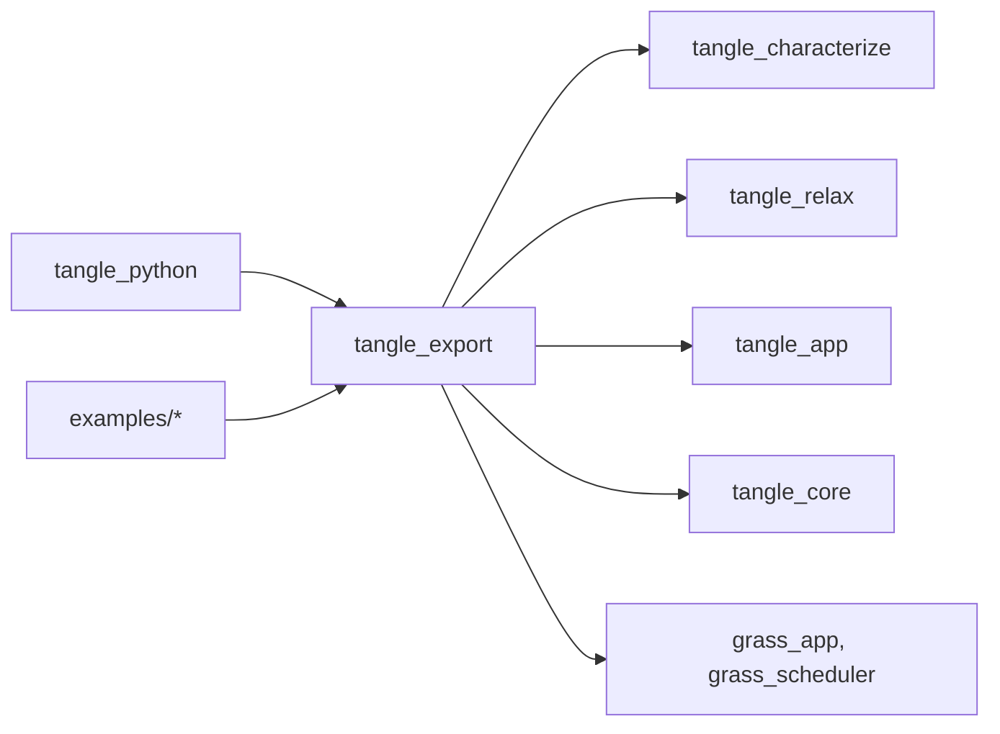
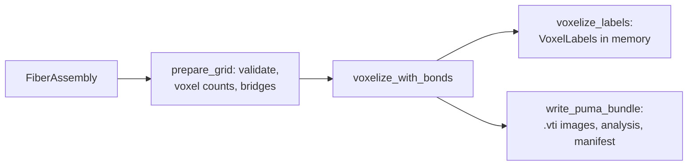

# tangle_export

Turns a TANGLE fiber assembly into the files other tools read: LAMMPS data files for bonded-particle models (BPM), OVITO dumps and trajectories, and PuMA voxel bundles. It also computes the voxel labels behind `tangle.fem` and the binder bridges that stand for persistent junctions in the OVITO and PuMA output. The Python package reaches all of it through `RunResult` and `Assembly` methods, and the example programs use its GRASS plugins.

Part of [TANGLE](../../README.md). See [the architecture](../../docs/architecture.md) for how the crates fit together. The user guides are [PuMA analysis and interoperability](../../docs/puma_interoperability.md), [FEM meshes](../../docs/fem_export.md), [LAMMPS BPM files](../../docs/lammps_bpm.md) and [Fiber bonds](../../docs/fiber_bonds.md).

## Contents

- [Where it fits](#where-it-fits)
- [What is in it](#what-is-in-it)
- [How it works](#how-it-works)
- [Using it](#using-it)
- [Tests](#tests)

## Where it fits



- [tangle_core](../tangle_core/README.md) gives it `FiberAssembly`: the cell, the placed and intrinsic centerlines, sections, materials, junctions and bend limits.
- [tangle_characterize](../tangle_characterize/README.md) writes the `tangle_analysis.json` that goes into every PuMA bundle (`characterize_assembly`, `write_analysis_json`).
- [tangle_relax](../tangle_relax/README.md) gives the trajectory plugin the solver's `RelaxationConfig`, `RelaxationState`, snapshots and `PackedAssembly`, and gives the OVITO writer `oval_lane_count`, so oval fibers are drawn with the same lanes the solver uses for contact.
- [tangle_app](../tangle_app/README.md) gives the plugins the workflow stages and phases and the `TANGLE_EXPORT` and `TANGLE_DEBUG_OUTPUT` capabilities.
- [tangle_python](../tangle_python/README.md) calls the writers from [recipe.rs](../tangle_python/src/recipe.rs) (`RunResult.export_bpm`, `write_ovito`, `export_puma`, and `Recipe.run`'s debug OVITO trajectory), [collection.rs](../tangle_python/src/collection.rs) (`Assembly.export_puma`) and [fem.rs](../tangle_python/src/fem.rs) (`fem_voxel_labels`, used by `tangle.fem.hex_mesh`).
- The programs under `examples/` add `BpmExportPlugin` and `OvitoTrajectoryPlugin` to their GRASS apps.

The LAMMPS data-file reader and rewriter in `tangle.lammps` is not here. It is plain Python in [lammps.py](../tangle_python/python/tangle/lammps.py); see [LAMMPS BPM files](../../docs/lammps_bpm.md). This crate only writes new BPM data files from an assembly.

## What is in it

About 5,200 lines, tests included.

| Module | What it does |
| --- | --- |
| [lib.rs](src/lib.rs) | the BPM model types (`DemParticle`, `DemCapsule`, `DemBond`, `DemAtomType`, `DemBpmModel`, `DemCapsuleBpmModel`, `BpmModel`), `BpmExportMode`, `BpmExportConfig`, `ExportError`, the two LAMMPS data writers, and shared helpers (`orthorhombic_bounds`, nearest-anchor lookup) |
| [bpm.rs](src/bpm.rs) | `build_bpm_model` for the four discretizations, `write_bpm_lammps_data`, `BpmExportReport`, and `BpmExportPlugin`, which exports in the `Export` stage |
| [bridges.rs](src/bridges.rs) | `junction_bridges` and `JunctionBridge`: one binder capsule per extra anchor of each persistent junction; `DEFAULT_BOND_RADIUS_RATIO` |
| [ovito.rs](src/ovito.rs) | `OvitoTrajectoryConfig`, `OvitoRepresentation`, `OvitoColoring`, `OvitoTrajectoryReport`; `write_ovito_assembly_frame`, `write_ovito_dump_frame` and `write_ovito_view_script` |
| [trajectory.rs](src/trajectory.rs) | `OvitoTrajectoryPlugin`, which turns the solver's debug snapshots into dump frames |
| [puma.rs](src/puma.rs) | `PumaVoxelExportConfig`, `write_puma_bundle`, `PumaExportReport`, `PumaExportError`, `PUMA_BUNDLE_SCHEMA_VERSION`, and `voxelize_labels` with `VoxelLabels` |

## How it works

### BPM data files

`build_bpm_model` turns the placed centerlines into particles chained by bonds, picked by `BpmExportMode`:

| Mode | Particles |
| --- | --- |
| `SpheresExact` | spheres at one constant spacing along the whole fiber; the unused arc length is split between the two ends |
| `SpheresDynamic` | spheres on every centerline vertex, with the spacing adjusted inside each segment |
| `SpherocylindersExact` (default) | one spherocylinder per active TANGLE segment |
| `SpherocylindersConstant` | each segment tiled with the shortest active segment length in the assembly, plus one shorter remainder |

Sphere spacing is `sphere_spacing_over_radius` times the fiber radius, and must lie in [1/3, 1]. Each fiber is one molecule. Consecutive particles of a fiber get the intra-fiber `bond_type`. Then every persistent junction adds a bond from the particle nearest its first anchor to the particle nearest each other anchor, with bond type `law + 2`. Material `n` becomes atom type `atom_type + n`. Particle centers on periodic axes are wrapped into the primary cell last, after the junction lookup, since TANGLE keeps periodic fibers unwrapped.

`write_bpm_lammps_data` writes a sphere model as a `bpm/sphere` data file (`Atoms` and `Bonds`) and a spherocylinder model with an extra `Capsules` section (atom ID, half length, axis). The column legends and the atom-type-to-material map are comments in the header.

### OVITO dumps

`write_ovito_assembly_frame` writes or appends one frame of a LAMMPS custom dump in one of three `OvitoRepresentation`s: `FiberSegments` (one spherocylinder per segment), `ConnectedFiberSegments` (a cylinder body per segment plus a sphere of type `atom_type + 1` at each vertex), or `DemParticles` (the bonded-sphere discretization). The capsule views carry per-segment curvature, curvature over the bend limit, and refinement level, which `OvitoColoring` picks in the generated script. An oval fiber is drawn as a row of round lanes along its long-axis director. With `bond_radius_ratio` set, each junction bridge is one more spherocylinder row of type `atom_type + 2`, `mol` 0, and its junction ID in the `junction` column. `write_ovito_view_script` writes a Python script for `ovitos` that loads the dump, styles it, and saves an `.ovito` session.

`OvitoTrajectoryPlugin` runs in the `Observe` phase. It writes the initial frame (unless `write_initial_frame` is off), the view script, then one frame per solver snapshot, and a final frame when the relaxation ends. The frame's timestep is the frame index.

### Binder bridges

`junction_bridges` resolves each junction anchor by walking the intrinsic (rest) centerline to its rest arc length, then taking the same segment coordinate on the placed centerline. The bridge runs from the first anchor to each other anchor, at the minimum periodic image. Its radius is the ratio times the thinner fiber's radius (the short semi-axis for an oval). [Fiber bonds](../../docs/fiber_bonds.md) explains the model.

### PuMA bundles and voxel labels



Both entry points share `prepare_grid` and `voxelize_with_bonds`, so `tangle.fem` meshes the same voxels a PuMA bundle holds. The voxel size must tile every cell edge; otherwise the error suggests counts that do. A voxel is solid when its center is inside a fiber's swept segment (or the oval sweep), checked over every periodic image that reaches the cell. The owner is the fiber with the smallest signed distance; ties within `ambiguity_tolerance` go to the smaller `FiberId` and are counted as ambiguous. Binder goes in afterwards and only fills voxels no fiber owns. `write_puma_bundle` writes `domain.vti` (UInt16 `phase_id`, Float32 `orientation`), the optional `fiber_ids.vti` and `interface.vti`, `bond_ids.vti` and `binder_interface.vti` when bonds are on, `tangle_analysis.json`, and a `manifest.json` that records the grid, the rules, FNV-1a hashes of each file and of the assembly, and the phase and fiber ID maps. [PuMA interoperability](../../docs/puma_interoperability.md#bundle-format-schema-1) documents the format.

### Invariants

- **Orthorhombic cells only.** Every writer here rejects a cell with off-diagonal basis terms (`NonOrthorhombicCell`).
- **BPM needs round fibers.** The BPM builders return `NonCircularSection` for an oval section. OVITO and PuMA handle ovals.
- **Two spacing conventions.** `BpmExportConfig::sphere_spacing_over_radius` is a multiple of the radius in [1/3, 1]. `OvitoRepresentation::DemParticles { spacing_ratio }` uses the older crate-private builder, where spacing is a fraction of the diameter in (0, 1].
- **Type numbering.** Bond type 1 is intra-fiber and junction bonds are `law + 2`. In OVITO dumps the vertex spheres are `atom_type + 1` and bridges `atom_type + 2`; the view script and [Fiber bonds](../../docs/fiber_bonds.md) rely on this.
- **Bonds off changes nothing.** With `bond_radius_ratio` `None`, every PuMA image is the same as for the same fibers without junctions, and `VoxelLabels::bond` is empty. A test checks this.
- **One rasterizer.** `voxelize_labels` and `write_puma_bundle` must keep using the same grid and voxelization code; a test checks that their labels match.
- **The bundle schema.** Change `PUMA_BUNDLE_SCHEMA_VERSION` when the bundle's files or manifest change shape. `PumaExportReport` derives `Deserialize`, and its binder fields use `#[serde(default)]` so a report written before them still loads. Python wraps it as `PumaExportReport` in [analysis.rs](../tangle_python/src/analysis.rs).
- **Frame interval.** `OvitoTrajectoryPlugin` asserts that the solver's `debug_snapshot_interval` equals `frame_interval`.

## Using it

```rust
use tangle_export::{
    build_bpm_model, write_bpm_lammps_data, write_puma_bundle, BpmExportConfig,
    BpmExportMode, PumaVoxelExportConfig,
};

let config = BpmExportConfig::new("out/fibers.data").with_mode(BpmExportMode::SpheresExact);
let model = build_bpm_model(&assembly, &config)?;
write_bpm_lammps_data(&model, &config.data_path)?;

let puma = PumaVoxelExportConfig::new("out/puma", 0.5).with_bonds(Some(1.0));
let report = write_puma_bundle(&assembly, &puma)?;
println!("{} of {} voxels solid", report.occupied_voxels, report.total_voxels);
```

| Entry point | Use |
| --- | --- |
| `build_bpm_model`, `write_bpm_lammps_data` | a LAMMPS BPM data file from an assembly |
| `BpmExportPlugin` | the same, as the `Export` stage of a GRASS app |
| `write_ovito_assembly_frame`, `write_ovito_view_script` | one OVITO frame and its viewing script |
| `write_ovito_dump_frame` | one frame of an already built `DemBpmModel` |
| `OvitoTrajectoryPlugin` | a relaxation trajectory from the solver's debug snapshots |
| `write_puma_bundle` | a PuMA bundle on disk |
| `voxelize_labels` | phase, owner-fiber and owner-junction labels in memory |
| `junction_bridges` | the binder bridges of an assembly's junctions |

From Python, `result.export_bpm(path, mode="spheres_exact")` takes the modes in snake case (hyphenated names still work), and `result.export_puma(directory, voxel_size, bond_radius_ratio=1.0)` returns the report.

## Tests

```sh
cargo test -p tangle_export
```

The tests build small assemblies on the host and need no GPU, but the crate depends on `tangle_relax`, which builds with its default `wgpu` and `cpu` features.

| Where | What |
| --- | --- |
| [lib.rs](src/lib.rs) | bonded spheres and capsules: consecutive bonds, material atom types, junction bonds, periodic wrapping |
| [bpm.rs](src/bpm.rs) | each `BpmExportMode`'s spacing and segment rules, and the spacing limits |
| [bridges.rs](src/bridges.rs) | a bridge across a crossing, across a periodic wall, and a rejected ratio; `touching_cross` is the fixture other modules reuse |
| [ovito.rs](src/ovito.rs) | dump columns, capsule orientation and length, the connected view, view-script paths and coloring, oval lanes, bond rows |
| [puma.rs](src/puma.rs) | multi-material bundles and manifest, non-tiling voxel sizes, periodic images, tie-breaking, oval volume, binder on and off, in-memory labels matching the bundle |
