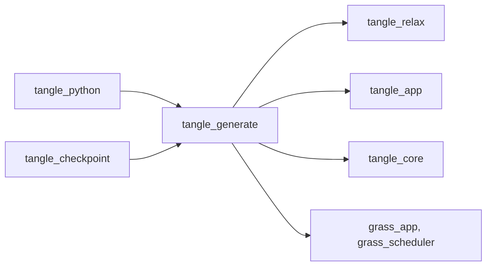
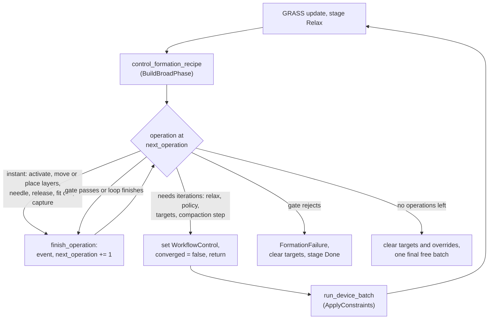

# tangle_generate

The seeded fiber generators and the formation recipe engine of TANGLE. The generators append fibers to a `FiberAssembly`: a point crossing, an angled pair, multi-segment fibers through the cell center, and statistically biased populations. The recipe engine is a GRASS controller that runs an ordered list of manufacturing operations (insert a layer, needle it, compact the cell, capture junctions) between GPU relaxation batches while the device world stays resident. The Python package uses both, and Rust examples install the plugins directly.

Part of [TANGLE](../../README.md). See [the architecture](../../docs/architecture.md) for how the crates fit together, and [Fiber bonds](../../docs/fiber_bonds.md) for what is done with captured junctions.

## Contents

- [Where it fits](#where-it-fits)
- [What is in it](#what-is-in-it)
- [How it works](#how-it-works)
- [Using it](#using-it)
- [Tests](#tests)

## Where it fits



- [tangle_core](../tangle_core/README.md) gives it `FiberAssembly`, sections, bend limits, formation layer and step labels, and junctions. Every generator writes into an assembly and records its provenance there.
- [tangle_app](../tangle_app/README.md) gives it the workflow stages (`TangleStage`), phases (`TanglePhase`) and capability ids that its plugins declare.
- [tangle_relax](../tangle_relax/README.md) owns the GPU device world. The recipe drives it through `WorkflowControl`, `RelaxationOverrides` and `DeviceWorld` calls (activate a formation step, layer and vertex targets, `compact_cell`, `capture_contacts`, checkpoints) and reads `RelaxationState` after each batch.
- [tangle_checkpoint](../tangle_checkpoint/README.md) saves `FormationRecipeState` in a restart file and puts it back on resume, so a recipe continues at the operation it was on.
- [tangle_python](../tangle_python/README.md) calls the generator functions from [generators.rs](../tangle_python/src/generators.rs), builds `FormationRecipeConfig`, compaction and junction policies in [recipe.rs](../tangle_python/src/recipe.rs), [compaction.rs](../tangle_python/src/compaction.rs), [junctions.rs](../tangle_python/src/junctions.rs) and [settings.rs](../tangle_python/src/settings.rs), and runs the recipe with `FormationRecipePlugin`.

## What is in it

About 5,800 lines, tests included.

### Generators

| Module | What it does |
| --- | --- |
| [lib.rs](src/lib.rs) | the public exports; `generate_point_crossing`, `PointCrossingConfig` and `PointCrossingGeneratorPlugin`: straight fibers on a Fibonacci sphere, all through the cell center |
| [orthogonal.rs](src/orthogonal.rs) | `generate_fiber_pair_crossing`, `FiberPairCrossingConfig`, `FiberPairCrossingGeneratorPlugin`: two straight fibers crossing at a set angle with a set axis separation |
| [multisegment.rs](src/multisegment.rs) | `generate_multisegment_crossing`, `MultiSegmentCrossingConfig`, `CenterlineShape`, `MultiSegmentCrossingGeneratorPlugin`: multi-segment fibers through the cell center with separate intrinsic and placed shapes |
| [population.rs](src/population.rs) | `generate_biased_fiber_population`, `FiberPopulationSpec`, `ScalarDistribution`, `OrientationDistribution`, `PositionDistribution`, `BiasedFiberPopulationGeneratorPlugin`: seeded populations in a box |

### Formation

| Module | What it does |
| --- | --- |
| [layered.rs](src/layered.rs) | `LayeredFormationPlugin`: a fixed schedule that pulls labeled layers closer in steps, then releases them |
| [recipe.rs](src/recipe.rs) | `FormationOperation`, `FormationRecipeConfig`, `FormationRecipePlugin`, `FormationRecipeState`; `SolvePolicy` and acceptance limits; needling (`NeedlingConfig`, `random_footprint_center`); the staged generator plugins |
| [recipe/compaction_control.rs](src/recipe/compaction_control.rs) | the compact, relax, measure loop behind `Compact` and `CompactWithOverrides`, with rollback; `FitCellToActiveFibers` bounds |
| [compaction.rs](src/compaction.rs) | `CompactionConfig`, `CompactionTarget`, `CompactionPath`, `AdaptiveCompactionIncrement`, `CompactionGuards`, the reports, and `nominal_fiber_volume` |
| [junctions.rs](src/junctions.rs) | `JunctionCapturePolicy`, `JunctionMaterialPair`, `JunctionCaptureReport`: turning GPU contacts into persistent junctions |
| [recipe_tests.rs](src/recipe_tests.rs) | tests of policy gates, needling selection and capsule bounds |

## How it works

### Generators

Each generator validates its config, adds a material and a section, appends fibers with both an intrinsic (rest) and a placed centerline, and writes `provenance.source` and notes. Each also comes as a GRASS plugin that runs once in `TangleStage::Generate` and then moves the workflow to `TangleStage::Relax`. A generator error panics inside the plugin; the function returns it as a `Result`.

- **Point crossing** places `count` straight fibers along Fibonacci sphere directions, all centered on the cell center.
- **Fiber pair** places two straight fibers in the xy plane, the second rotated by `crossing_angle_degrees`, offset by plus and minus half of `axis_separation` along z.
- **Multisegment** uses the same Fibonacci directions with `segments_per_fiber` segments. `intrinsic_shape` and `placed_shape` are each `Straight` or `Curved { amplitude }` (a sine mode plus a half-amplitude second harmonic, handedness alternating every two fibers). `placed_chord_fraction` below one places the fiber shorter than its rest length, which gives slack. A `minimum_bend_radius` is checked against the intrinsic shape only, so the placed shape may start over-bent.
- **Population** draws every value from one SplitMix64 stream seeded by `spec.seed`. For each fiber it samples length, radius, waviness amplitude and handedness, rejects intrinsic shapes that break `minimum_bend_radius`, samples a direction (`Isotropic3d`, `Planar`, `LayeredBiaxial`, `Aligned`), then samples a center inside the region where the whole swept fiber fits. On periodic axes the center spans the full cell instead. `PositionDistribution::Layered` assigns each fiber a layer first and places it on that layer with jitter; it also sets the fiber's formation layer. `DensityGradient` biases the center with a power law. After `max_attempts_per_fiber` failures it returns `PlacementExhausted`. `thickness_ratio` below one makes elliptical sections. The cell must be orthorhombic.

The staged plugins in [recipe.rs](src/recipe.rs) generate populations for a recipe. `StagedFiberPopulationGeneratorPlugin` tags each population with its own `formation_step`. `LayerStagedFiberPopulationGeneratorPlugin` and `MixedLayerStagedFiberPopulationGeneratorPlugin` set `formation_step = first_formation_step + formation_layer`, so layer n is inserted at step `first_formation_step + n`. The mixed plugin generates several materials into the same layers and can assert a `minimum_layer_clearance` between neighbouring layers' radius-expanded envelopes.

### A recipe's run

`FormationRecipePlugin` checks every operation's parameters when it is built, then adds `control_formation_recipe` in `TangleStage::Relax` at `TanglePhase::BuildBroadPhase`. tangle_relax uploads the device world in `PrepareGeometry` and runs one GPU batch in `ApplyConstraints`, so the controller runs before every batch. It never runs the solver itself. It steers the next batch through `WorkflowControl`: `hold_relax_stage` keeps the workflow in `Relax` after a converged batch, `batch_iteration_limit` caps the batch so it ends where the operation wants to look again, `force_full_batch` turns off early convergence for fixed intervals, and `penetration_tolerance` and `maximum_curvature_ratio` carry a policy's solver targets.



Operations that only change device state finish in the same frame and the loop moves on. Operations that need iterations remember where they started in `relaxation_started_at`, ask for the rest, and return. When all operations are done the controller clears every target and override, releases the workflow and sets `converged = false`, so one last unconstrained batch runs. `FormationRecipeState` holds the event log, warnings, needling, compaction and junction reports, and any failure.

### Operations

| Operation | What it does |
| --- | --- |
| `ActivateFibersThrough(step)` | activates prepacked fibers with `formation_step <= step` on the device, without uploading again |
| `SetMaterialBendRadius` | sets the bend limit of every fiber of one material, on the host and on the device; an unknown or empty material stops the recipe |
| `RelaxFor(n)` | exactly `n` iterations, with early convergence off |
| `RelaxUntilConverged` | relaxes until the solver converges; failing within the budget stops the recipe |
| `RelaxWithPolicy`, `RelaxWithOverrides` | relaxes toward a `SolvePolicy`'s solver targets and checks its hard and soft acceptance limits; the second also applies `RelaxationOverrides` for this operation only |
| `RelaxUntilTargetsReached` | relaxes until the largest layer or needle target error is within `tolerance` |
| `MoveLayers` | holds every layer at its initial center scaled by `spacing_scale` about the cell center |
| `PlaceLayerAbove` | holds one layer a `gap` above the previous layer's target |
| `NeedleLayer`, `ReleaseNeedles` | sets or clears needle pull targets on chosen vertices |
| `ReleaseLayerTargets` | stops applying layer targets |
| `FitCellToActiveFibers` | shrinks chosen nonperiodic axes to the active capsules plus `padding` |
| `Compact`, `CompactWithOverrides` | shrinks the cell in steps to a target (below) |
| `CaptureJunctions`, `RelaxAndCapture` | turns current contacts into junctions once, or every `every` iterations of a relaxation |

### Policy gates

`policy_gate` decides a `RelaxWithPolicy` step after each batch. It accepts when the latest batch measured the current geometry and every limit holds. Otherwise it keeps solving while the main `maximum_iterations` budget lasts. Once that is spent, `SolveExhaustion::ContinueIfHardLimitsSatisfied` continues with a `FormationWarning` if only `Soft` limits fail. If not, solving goes on for up to `extra_iterations` more (by default half the budget, `SolvePolicy::default_extra_iterations`), and then rejects. The extension stops one iteration short of the run's `max_iterations`, so a rejection is always recorded at a batch boundary. A rejection, like any failed gate, sets `FormationFailure`, clears targets and moves to `TangleStage::Done`; Python raises it as a recipe error.

### Layers and needling

Layer targets come from `layer_targets`: the mean placed coordinate along `layer_axis` of every fiber in each formation layer. The device moves each layer toward its target by a `stiffness` fraction per iteration, capped at `max_translation`. `LayeredFormationPlugin` in [layered.rs](src/layered.rs) is a simpler fixed schedule of the same idea: an initial relax, then `compaction_steps` steps down to `final_spacing_scale`, then release.

`NeedleLayer` picks at most one internal vertex from each active fiber of the layer, optionally only fibers at least `minimum_fiber_diameter` thick. `RandomFiberFraction` picks fibers by a SplitMix64 hash of the seed and fiber id. `CircularFootprint` picks, on each fiber, the vertex nearest the footprint center among active segments that pass within the footprint, with periodic wrapping in the plane. `random_footprint_center` gives a seeded footprint center per layer. The chosen vertices are pulled `depth` toward the negative layer normal. Each iteration's move is capped at `max_translation` and at `maximum_translation_over_fiber_diameter` times the thinnest chosen fiber's diameter. With adaptive segmentation on, the chosen vertices are refined first.

### Compaction control

`advance_compaction` keeps an `ActiveCompaction` in the recipe state across frames:

1. Relax unconstrained first and keep that state as the accepted baseline (a `DeviceWorldCheckpoint`). If the baseline does not converge within `maximum_relax_windows` windows, stop with a guard.
2. Check the guards (steps, penetration, bend ratio, pressure, penalty energy), then the target (`NominalVolumeFraction`, `CellVolume`, `CellLengths`, `MeanPressure`, `DirectionalPressure`, `PenaltyEnergy`).
3. Split the next log volume strain among axes by the `CompactionPath`: fixed `AxisWeights`, `EqualPressure` or `StressRatio` from measured pressures, or `MinimumIncrementalWork` (all strain on the active axis with the lowest pressure). Cap it so no wall moves more than `maximum_shortening_over_minimum_diameter` times the thinnest active fiber, and keep each edge above about twice the largest radius.
4. Place the new faces by `cell_anchor`, or between the face anchor and the less loaded face when `balance_opposing_faces` is on, and call `compact_cell` with the chosen `CompactionKinematics`.
5. Relax for up to `relax_iterations`. On convergence accept the step, report it, checkpoint the device, and grow the strain if it converged within half the window, otherwise shrink it. On failure roll the device back to the last accepted checkpoint and retry with a smaller strain; at the minimum strain, or after too many windows, stop as `Jammed`.

`nominal_fiber_volume` is the sum of section area times intrinsic arc length of active fibers, without end caps or junction overlap.

### Junction capture

`capture_junctions` asks the device for contacts within `maximum_surface_gap` (at most `candidate_capacity`). `form_junctions_from_capture` sorts them by gap and segment, then for each checks crossing angle, material pair, a deterministic hash of the seed and anchors against `probability`, `maximum_per_fiber_pair`, and `minimum_anchor_separation` from existing junctions. Accepted contacts become two-anchor junctions at rest arc lengths, under a junction law found or added by `law_name`.

### Invariants

- **Same seed, same assembly.** Every random choice comes from SplitMix64 streams in a fixed order. Changing the order of draws in `generate_biased_fiber_population` changes every population ever generated from a seed.
- **Ids.** The population generator numbers new fibers after the largest existing id. The point, pair and multisegment generators number from 1, so they expect an empty assembly.
- **Every device change sets `converged = false`.** Otherwise the solver skips the next batch and the recipe waits on a result that never comes.
- **An operation that finishes clears `relaxation_started_at`**, or the next relaxation operation thinks it has already run.
- **The controller runs before the batch.** It is in `BuildBroadPhase` and the batch in `ApplyConstraints`; it reads the state of the previous batch.
- **Layer labels are contiguous.** `layer_targets` asserts every layer from 0 to the largest label has fibers. `LayeredBiaxial` orientation needs a `Layered` position.
- **Needling a layer needs it inserted.** `NeedleLayer` checks that the active formation step is at least the layer number, which matches the layer-staged generators when `first_formation_step` is 0.
- **Compaction keeps a rollback point.** A trial step is accepted only after a converged relaxation; otherwise the device returns to `accepted_device`.
- **Junction capture must not overflow.** `form_junctions_from_capture` panics when the device capture overflowed; raise `candidate_capacity` instead.
- **`FormationRecipeState` is in restart files.** tangle_checkpoint serializes it, private fields included. Changing its fields changes what old checkpoints can resume.

## Using it

A layer-staged recipe, as the needled preform examples build it:

```rust
use grass_app::prelude::*;
use tangle_app::prelude::*;
use tangle_core::PeriodicCell;
use tangle_generate::{
    CompactionConfig, FiberPopulationSpec, FormationOperation, FormationRecipeConfig,
    FormationRecipePlugin, LayerStagedFiberPopulationGeneratorPlugin, PositionDistribution,
};
use tangle_relax::{RelaxationConfig, RelaxationPlugin};

let spec = FiberPopulationSpec {
    position: PositionDistribution::Layered { axis: 2, layers: 3, jitter_fraction: 0.2 },
    ..FiberPopulationSpec::default()
};
let mut app = App::new();
app.add_plugins(TangleWorkflowPlugin::default())
    .add_plugins(TangleAssemblyPlugin::new(PeriodicCell::orthorhombic([1.0; 3], [true, true, false])))
    .add_plugins(LayerStagedFiberPopulationGeneratorPlugin { spec, first_formation_step: 0 })
    .add_plugins(RelaxationPlugin { config: RelaxationConfig::default() })
    .add_plugins(FormationRecipePlugin {
        config: FormationRecipeConfig {
            layer_axis: 2,
            operations: vec![
                FormationOperation::ActivateFibersThrough(2),
                FormationOperation::RelaxFor(256),
                FormationOperation::Compact(CompactionConfig::volume_fraction(0.2, [0.0, 0.0, 1.0])),
            ],
        },
    });
app.start();
```

| Entry point | Use |
| --- | --- |
| `generate_point_crossing`, `generate_fiber_pair_crossing`, `generate_multisegment_crossing`, `generate_biased_fiber_population` | append fibers to an assembly directly (Python's generators call these) |
| the `*GeneratorPlugin` types | the same, once, in the Generate stage of a GRASS app |
| `StagedFiberPopulationGeneratorPlugin`, `LayerStagedFiberPopulationGeneratorPlugin`, `MixedLayerStagedFiberPopulationGeneratorPlugin` | generate populations tagged for insertion by a recipe |
| `FormationRecipePlugin`, `FormationRecipeState` | run a recipe and read its events, reports and failure |
| `LayeredFormationPlugin` | a fixed layer-compaction schedule without a recipe |
| `CompactionConfig::volume_fraction`, `JunctionCapturePolicy::touching` | starting configs for compaction and junction capture |
| `nominal_fiber_volume`, `random_footprint_center` | helpers also used by callers |

Python starts its recipe app directly in `TangleStage::Relax` with a prepared assembly ([recipe.rs](../tangle_python/src/recipe.rs), `run_native_recipe`), so it uses the generator functions, not the generator plugins. The [examples](../../examples/README.md) (`needled_preform_two_fiber`, `felt_20ply_control_vs_needled`, `biased_fiber_box`, `multisegment_flexible_relaxation`) use the plugins.

## Tests

```sh
cargo test -p tangle_generate
```

The tests run on the host and need no GPU.

| Where | What |
| --- | --- |
| [lib.rs](src/lib.rs) | every point-crossing fiber passes through the cell center |
| [orthogonal.rs](src/orthogonal.rs), [multisegment.rs](src/multisegment.rs) | pair geometry; straight and curved intrinsic and placed shapes, over-bent placement allowed, center vertices |
| [population.rs](src/population.rs) | same seed gives the same assembly, containment, no edge depletion on periodic axes, angular support, biaxial mixture, flat ovals |
| [layered.rs](src/layered.rs) | layer center targets |
| [compaction.rs](src/compaction.rs) | nominal volume, minimum-work axis choice, the diameter cap |
| [junctions.rs](src/junctions.rs) | a contact becomes one junction with material-coordinate anchors |
| [recipe_tests.rs](src/recipe_tests.rs) | capsule bounds, soft limit deferral, policy extension, needling selection (reproducible, internal, layer-scoped; footprint), footprint centers |
| [examples/multisegment_flexible_relaxation/tests/shape_regression.rs](../../examples/multisegment_flexible_relaxation/tests/shape_regression.rs) | every multisegment shape case relaxes to an admissible assembly (an example's test, run from that example) |
