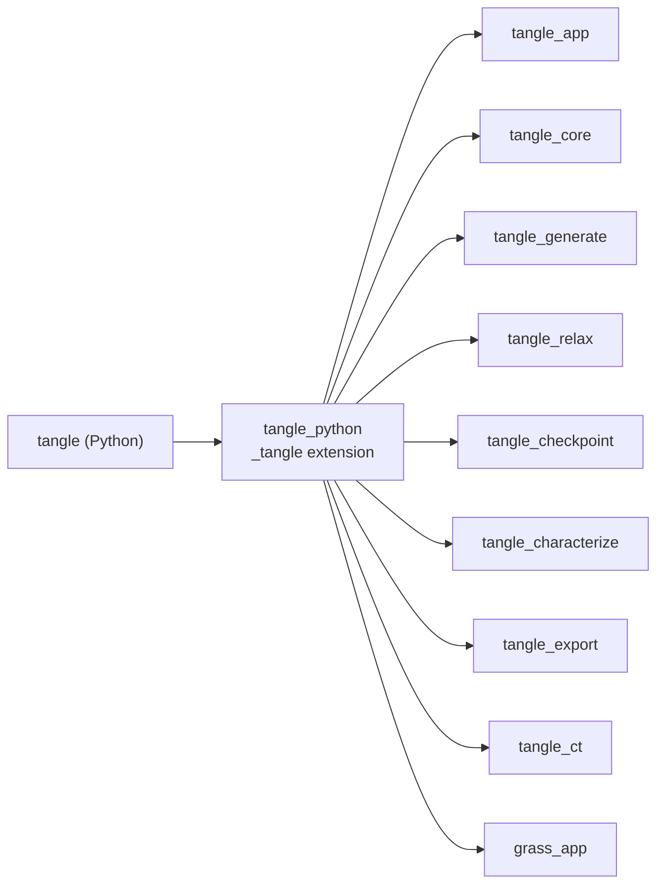

# TANGLE Python guide

Python is the primary user path for TANGLE. Python constructs fiber
collections and manufacturing recipes; the existing Rust implementation owns
validation, CubeCL device residency, relaxation, refinement, and export.

The extension is compiled code. A development install requires Python 3.11 or
newer, a stable [Rust toolchain](https://rustup.rs/) including Cargo, a native
C/C++ compiler/linker, and network access for the first dependency build.
CubeCL's build dependency downloads its matching bundled LLVM automatically;
users do not need a system LLVM installation or `llvm-config`.

## Quick start

From the repository root, with Rust and Python 3.11+ installed:

```console
python3 -m venv .venv-tangle
source .venv-tangle/bin/activate
python -m pip install "maturin>=1.8,<2"
maturin develop --release --extras ct --manifest-path crates/tangle_python/Cargo.toml
python crates/tangle_python/python/examples/quickstart.py
```

`--extras ct` also installs what `tangle.ct` (CT fitting) needs: NumPy, SciPy,
tifffile and matplotlib. The core `tangle` package needs none of them.
[`quickstart.py`](python/examples/quickstart.py) builds and relaxes a small
fiber network, then fits it back from a simulated CT scan:

```python
import tangle
import tangle.ct as ct
from tangle.units import um

cell = tangle.Cell([120 * um] * 3, periodic="xyz")
fiber = tangle.Material("fiber", diameter=10 * um, min_bend_radius=50 * um)
population = tangle.FiberPopulation(material=fiber, count=40, length=(60 * um, 100 * um))

recipe = tangle.Recipe(cell)          # steps are recorded here...
recipe.insert(population)
result = recipe.run()                 # ...and simulated here, on the GPU
result.write_ovito("network.dump")

scan = ct.synthetic_ct(result, voxel_size=1.5 * um)
fit = ct.fit_fibers(scan.volume, scan.voxel_size, ct.FiberSpec(diameter=10 * um))
fit.write("fit", volume=scan.volume)  # fit.json, labels.tif, overlay.png
```

Lengths are in meters. Length settings you leave unset follow the fiber
diameter: `RelaxationSettings.penetration_tolerance` is 1% and `max_step` 10%
of the smallest fiber diameter, and a `FiberPopulation`'s `length` is 16-24
and `curvature_amplitude` 0-0.8 diameters. Without a GPU, use
`recipe.run(tangle.RelaxationSettings(backend="cpu"))` and
`ct.FitSettings(backend="cpu")`. The sections below cover installation in
more detail (Windows, Conda, notebooks) and the rest of the API.

## Installing in detail

Obtain the source with Git (or download and unpack the repository):

```console
git clone https://github.com/SueHeir/tangle.git
cd tangle
```

For a first Rust installation on macOS, Linux, or WSL, use the official Rustup
installer and verify both compiler and package manager:

```console
curl --proto '=https' --tlsv1.2 -sSf https://sh.rustup.rs | sh
source "$HOME/.cargo/env"
rustup toolchain install stable
rustup default stable
rustc --version
cargo --version
```

On Windows, run the official `rustup-init.exe` from
[rust-lang.org/tools/install](https://rust-lang.org/tools/install/), select the
stable MSVC toolchain, and install the Visual Studio Desktop C++ build tools if
prompted.

The commands below install Maturin into the active Python environment with
`pip`, which keeps it aligned with the selected interpreter. Users who prefer
a Rust-managed global CLI may instead run `cargo install --locked maturin` and
then activate the intended Python environment before `maturin develop`. Do not
install Maturin both ways unless you intentionally want both copies.

Then create and activate the Python environment and let Maturin invoke Cargo
and install the compiled extension, all from the repository root. The following
uses a POSIX shell; tutorial 00 also gives Windows PowerShell commands.

```console
python3 -m venv .venv-tangle
source .venv-tangle/bin/activate
python -m pip install --upgrade pip
python -m pip install "maturin>=1.8,<2" jupyterlab ipykernel
maturin develop --release --extras ct \
  --manifest-path crates/tangle_python/Cargo.toml
```

Activating the environment is important: it sets `VIRTUAL_ENV`, which tells
Maturin exactly where to install the compiled module even if another `.venv`
directory exists nearby.

Miniforge users can replace the `venv` commands with a named Conda environment.
Rust/Cargo and the native compiler are still separate prerequisites:

```console
conda create --name tangle python=3.12 -y
conda activate tangle
python -m pip install --upgrade pip
python -m pip install "maturin>=1.8,<2" jupyterlab ipykernel
maturin develop --release --extras ct \
  --manifest-path crates/tangle_python/Cargo.toml
python -m ipykernel install --user \
  --name tangle --display-name "Python (TANGLE)"
```

Use the named `tangle` environment rather than Conda's `base` environment, then
select **Python (TANGLE)** in VS Code or Jupyter.

These are source-build instructions, not a request to install an unrelated
package from PyPI with the same name. Clone this repository first and run build
commands at its root. Prebuilt wheel distribution is not provided here yet.

For Windows PowerShell, after installing Rust and the native build tools:

```powershell
py -m venv .venv-tangle
.\.venv-tangle\Scripts\Activate.ps1
python -m pip install "maturin>=1.8,<2" jupyterlab ipykernel
maturin develop --release --extras ct --manifest-path crates/tangle_python/Cargo.toml
python -m ipykernel install --user --name tangle --display-name "Python (TANGLE)"
```

[Tutorial 00](python/tutorials/00_installation_and_environment.ipynb) contains
cross-platform setup, kernel registration, verification, and rebuild commands.
After rebuilding a loaded extension, restart the notebook kernel. For a failed
import, check `import sys; print(sys.executable)` and select the environment in
which Maturin installed TANGLE. Windows setup is documented but is not currently
covered by platform CI.

See `python/examples/` for executable scripts and matching Jupyter notebooks.
The notebooks contain the same calculations split into explanatory, editable
cells. To explore them interactively:

```console
cd crates/tangle_python/python/examples
jupyter lab
```

For a setting-by-setting reference, use `python/tutorials/`. Its fifteen
focused notebooks cover cells, materials, centerlines, collections, generators,
insertion, relaxation, adaptive segmentation, solve policies, layer motion,
needling, compaction, junction capture, checkpoints, results, OVITO, and BPM
export. Each configuration notebook enumerates every exposed field and its
units or accepted choices.

`python/examples/native/` contains Python script/notebook pairs for the native
manufacturing configurations; the PuMA fixture is in `python/examples/`.
See the [progressive example index](../../examples/README.md). Output paths,
export modes, and checkpoint identities can differ between front ends. The larger felt
notebooks retain their full scientific configurations but guard the expensive
execution cell so opening a notebook does not accidentally start an hours-long
run.

## Collections and staged insertion

`FiberCollection` is a detached, reusable set of centerlines. It does not need
to be contact-free. Each fiber carries its placed centerline, optional distinct
rest centerline, material, optional formation layer, and arbitrary string tags.

```python
import tangle

from tangle.units import mm, um

small = tangle.Material("small", diameter=7 * um, min_bend_radius=35 * um)

layer = tangle.FiberCollection("ply_01")
layer.add_fiber(
    [[-0.4 * mm, 0, 0], [0.4 * mm, 0, 0]],
    small,
    tags={"family": "machine_direction"},
    formation_layer=1,
)

cell = tangle.Cell([1 * mm, 1 * mm, 2 * mm], periodic="xy")
recipe = tangle.Recipe(cell)
ply = recipe.insert(layer, translation=[0.5 * mm, 0.5 * mm, 0.8 * mm])
recipe.relax_until_converged()
```

`insert()` returns a stable `FiberSelection` containing the assigned fiber IDs
and formation step. Every collection is packed once; recipe activation and
relaxation then occur inside one Rust/CubeCL execution. Layers stack along the
cell's `stack_axis`: z when z is bounded or every axis is periodic, otherwise
the last bounded axis. Pass
`stack_axis="x"` to `Cell` or `Recipe` to choose another. Generators,
compaction and `fit_cell_to_active_fibers` default to the same axis. Recipe
operations are ordered manufacturing instructions, not physical timesteps.

`insert()` changes the recipe's starting assembly immediately; every other
operation is recorded and runs inside `run()`. A recipe with only inserts
relaxes until converged when run; once it has any other step, add
`relax_until_converged()` where you want the fibers relaxed. `run()` does not modify the
input `Assembly`: read the result from `result.assembly`. A failed operation
raises `tangle.RecipeError`, which carries `operation_index`, `operation`,
`iteration` and `reason`.

## Defaults and overrides

Configuration classes follow three naming conventions. `*Settings` are
run-wide, a `*Policy` is a named rule applied at one recipe step, and
`*Overrides` are temporary deltas for the step they are passed to.

Calling a constructor with no arguments exposes the corresponding Rust
defaults. Every field is also a keyword argument, can be inspected or changed
before the run, and `replace(**changes)` returns a modified copy. An unknown
keyword raises `TypeError`, and an unknown option string raises `ValueError`
on the line that set it:

```python
settings = tangle.RelaxationSettings(
    penetration_tolerance=0.1e-6,
    max_iterations=20_000,
    cell_size_scale=1.25,
    adaptive_segmentation=tangle.AdaptiveSegmentationSettings.profile(
        "balanced", refinement_interval=4, coarsening_persistence=48
    ),
)
print(settings.to_dict())
quick = settings.replace(max_iterations=2_000)
```

WGPU remains the default backend. On a system without a usable GPU, select
CubeCL's native multithreaded CPU runtime; the recipe and numerical settings do
not otherwise change:

```python
result = recipe.run(settings.replace(backend="cpu"))
```

The packaged extension includes both `wgpu` and `cpu`. Backend selection is
explicit so a large run never silently falls back to a much slower device.

Available adaptive profiles are `balanced`, `fast`, and `strict`. Profiles are
ordinary settings objects, not hidden solver modes. Assign `None` to
`settings.adaptive_segmentation` to disable refinement and coarsening.

Recipe-stage controls use the same pattern. Compaction exposes its target,
axis-selection path, kinematics, adaptive increment, guards, face balancing,
and penalty-energy weights:

```python
compaction = tangle.CompactionSettings.volume_fraction(
    0.40,  # compresses along the stack axis unless path= says otherwise
    balance_opposing_faces=True,
    max_penetration=0.1e-6,
)
recipe.compact(compaction)

pressure = tangle.CompactionSettings(
    tangle.MeanPressureTarget(1.0e3),
    path=tangle.EqualPressurePath("xy"),
)
```

Targets (`VolumeFractionTarget`, `CellVolumeTarget`, `CellLengthsTarget`,
`MeanPressureTarget`, `DirectionalPressureTarget`, `PenaltyEnergyTarget`) and
paths (`AxisWeightsPath`, `EqualPressurePath`, `StressRatioPath`,
`MinimumWorkPath`) are typed objects, so each carries only the fields it uses.

`SolvePolicy` sets a step's convergence targets and hard/soft gates, and
`RelaxationOverrides` temporarily shifts contact-versus-bending emphasis:

```python
recipe.solve(
    tangle.SolvePolicy(
        "cleanup/1-curvature-coarse",
        target_penetration=2e-6,
        target_curvature_ratio=1.25,  # max_* limits default to the targets
        max_iterations=30_000,
    ),
    tangle.RelaxationOverrides.preset("curvature_cleanup"),
)
```

Layer placement and needling hold fibers on targets until released. Use them
as context managers to release at the end of the block. A layer is numbered by
the `insert()` call that added it, from 0; this recipe has one:

```python
with recipe.needle_layer(
    0,
    footprint=tangle.CircularFootprint.random(diameter=150 * um, seed=7),
    depth=350 * um,
):
    recipe.settle_targets(tolerance=0.5 * um, max_iterations=3_000)
    recipe.relax_for(150)
```

`JunctionPolicy` provides explicit,
deterministic contact-to-junction capture; contacts remain transient unless a
recipe includes `capture_junctions()` or `relax_and_capture()`.
Captured junctions are not mechanically enforced by subsequent relaxation.
Prefer late capture when representing binder added after the material settles.

Long recipes can use the same rolling, atomic restart checkpoints as native
TANGLE applications:

```python
checkpoint = tangle.CheckpointSettings(
    "three-ply-study",
    "output/three_ply.restart",
    interval_iterations=500,
)
result = recipe.run(settings, checkpoint=checkpoint)
print(result.checkpoint_saves, result.last_checkpoint_iteration)
```

Use `checkpoint.replace(resume=True)` to continue the saved recipe. A separate
`resume_path` and `resume_case_id` can be used to branch a run into a new
checkpoint file.
Cross-revision checkpoint compatibility is not guaranteed. Preserve the source
commit, settings, backend, and a geometry export alongside long-lived studies.

## Acceptance and OVITO keyframes

Inspect `result.converged`, `max_penetration`, `max_curvature_ratio`, `warnings`,
and `events` before treating geometry as mechanically admissible. Export methods
do not themselves prove convergence. A soft intermediate recipe gate can be
useful during formation but is not a final hard acceptance check.

To record formation milestones rather than regular solver frames:

```python
from pathlib import Path

output = Path("output/my_study")
output.mkdir(parents=True, exist_ok=True)
settings.debug_snapshot_interval = None  # keyframes only when debug path is supplied
result = recipe.run(
    settings,
    debug_ovito_path=output / "formation.dump",
    debug_ovito_view_script_path=output / "formation_view.py",
    debug_ovito_session_path=output / "formation.ovito",
)
```

Without `debug_ovito_path`, no debug trajectory is requested. With it, `None`
selects keyframes; a positive `debug_snapshot_interval` adds periodic snapshots.
The viewing script must be run with OVITO Python/`ovitos` to create the session
file. `result.write_ovito(...)` instead exports one final-state frame. Dense
trajectories add device readbacks and can substantially slow a solve.

## BPM export

`RunResult.export_bpm()` writes solver-neutral bonded-particle geometry. Choose
`spheres_exact`, `spheres_dynamic`, `spherocylinders_exact`, or
`spherocylinders_constant`. Sphere spacing is measured in fiber radii and may
range from `1/3` through `1`:

```python
particles, bonds = result.export_bpm(
    "output/network.data",
    mode="spheres_dynamic",
    sphere_spacing_over_radius=1.0 / 3.0,
    density=1800.0,
)
```

The spherocylinder modes write a data file for LAMMPS's `atom_style bacillus`
(the capsule code on the `spherocylinder-nufeb` LAMMPS branch, not stock
LAMMPS): one capsule atom per segment at its center of mass, an `N bacilli`
header line, `Atoms` rows `id molecule type 1 density x y z`, and a `Bacilli`
section with each capsule's inertia tensor, pole (half its axis) and diameter
in the box frame. The bonds join the centers of neighbouring capsules along
each fiber, for `bond_style bpm/guo`. Every capsule is at least one fiber
diameter long (`min_capsule_length_over_diameter=1.0`; `0` keeps every
segment): shorter segments merge with the next, since a shorter capsule would
overlap the capsule two along its fiber, which it isn't bonded to, and the BPM
bond styles keep pair forces on between those two; contacts are `pair_style
granular/bacillus` and walls `fix wall/gran/bacillus` in the input script.
The sphere modes write `atom_style bpm/sphere`.
The column names of each section are in the comments at the top of the file.

Each fiber type gets its own atom type and its own bond type for the bonds
along its fibers, numbered from `atom_type` and `bond_type`; bonds from
junctions take the bond types after them, one per junction law. By default a
fiber type is a material. `fiber_types=` (each fiber's zero-based type, in
fiber order) and `type_names=` group the fibers yourself; a CT fit does this
for its own fiber types with `relaxed.export_bpm(run, path)`, so two fiber
diameters give atom types 1 and 2 and bond types 1 and 2, thinnest first. The
Python export takes one density for all types.

A CT fit's capsule export also writes two LAMMPS inputs next to the data file
(`tangle.ct.write_bpm_lammps_inputs` writes them for any capsule file):
`in.atom_types`, to `include` after `read_data`, which sets
`special_bonds`, `comm_modify` and `neighbor` for the model, a group and type
label per fiber type, each type's `granular/bacillus` contacts and `bpm/guo`
bonds from placeholder material values (index variables such as `E_1`, set
before the include or with `-var`), and `dt`, a stable timestep; and
`in.tensile`, an example that settles the fibers, holds the capsules near both
ends of the sample along `axis` and pulls one end at constant speed to
`max_strain`, writing strain, stress and both grip forces to `tensile.txt`, and
the capsules and bonds to `tensile.dump` and `tensile_bonds.dump` for OVITO
(particle shape Spherocylinder):

```bash
lmp -in in.tensile -var axis x -var max_strain 0.02 -var E_1 3.0e9
```

`relaxed.export_bpm(run, path, lammps_inputs=False)` skips them. Before the
export, `fit.relax(defined_radii=True)` puts every fiber back at its type's
defined diameter (`FiberSpec.diameter`) instead of the fitted one and relaxes
the overlaps that makes.

For fibers found in a CT scan, `tangle.ct.add_bpm_binder_bonds` and
`tangle.ct.add_bpm_binder_spheres` add the binder the scan shows, as bonds
between fibers or as spheres bonded to each other and to the fibers (in a
capsule file, capsules of no length), and
`tangle.ct.write_bpm_ovito` writes a file to look at in OVITO (see the
[CT network tutorial](../../docs/ct_unet_tutorial.md#7-into-tangle)).
Constitutive laws and contact exclusions belong to the downstream model.
Intentional intra-fiber sphere overlap must not be confused with unwanted
inter-fiber penetration.

## LAMMPS BPM files in and out

`tangle.lammps` relaxes the fibers of a LAMMPS bonded-particle data file and
writes the file back with only the moved spheres' positions changed:

```python
from tangle import lammps

data = lammps.read_data("fibers.data", periodic="p p f")  # the input script's boundary
run = data.relax()
data.write_data("fibers_relaxed.data", run)
```

A fiber is a chain of bonded spheres in one molecule, in `bpm/sphere`, `bond`
or another atom style. Atoms in no chain stay where they are, and `data.notes`
says which. The [LAMMPS BPM guide](../../docs/lammps_bpm.md) covers how the
fibers are found, the walls on axes that aren't periodic, and the bonds' rest
state.

## Native analysis and PuMA export

`Assembly.characterize()` and `RunResult.characterize()` dispatch to the Rust
`tangle_characterize` crate. The returned report includes exact centerline
lengths, nominal swept-volume fraction, per-material and per-fiber summaries,
curvature, and both length- and volume-weighted orientation tensors.

`export_puma()` dispatches to the Rust `tangle_export` voxelizer and writes a
directory containing `domain.vti`, optional diagnostic images, a manifest, and
the same native analysis as JSON:

```python
analysis = result.characterize()
bundle = result.export_puma(
    "output/specimen.puma",
    voxel_size=2e-6,
    include_fiber_ids=True,
    include_interface=True,
)
print(analysis.nominal_swept_volume_fraction)
print(bundle.voxel_volume_fraction, bundle.ambiguous_voxels)
```

With captured junctions, `bond_radius_ratio=` (a fraction of the thinner
fiber's radius) also voxelizes each junction as a binder bridge, in its own
phase with `bond_ids.vti` and `binder_interface.vti`. `write_ovito` draws the
same bridges as bonds by default. See
[docs/fiber_bonds.md](../../docs/fiber_bonds.md).

### Contacts and neighbors

`characterize_neighbors(contact_gap, ...)` on an `Assembly` or `RunResult`
measures how fibers touch and travel together, which volume fraction and
orientation tensors cannot show. It reports contacts per unit length and
per fiber, the ratio to a random-placement baseline, the split between
in-axis (side-by-side) and out-of-axis (crossing) contacts, how much longer
contacts last than a straight crossing would ("excess persistence"), free
lengths between contacts, neighbor counts, and how quickly each fiber's set
of neighbors changes along its length:

```python
neighbors = result.characterize_neighbors(
    contact_gap=0.3e-6,        # surface gap counted as touching
    neighbor_gap=10e-6,        # surface gap counted as a neighbor
    in_axis_angle_degrees=20,  # below this, fibers run side by side
)
print(neighbors.contacts_per_length, neighbors.contact_ratio_to_random)
print(neighbors.in_axis_contact_fraction, neighbors.neighbor_correlation_length)
neighbors.write_json("output/neighbors.json")
```

The analysis uses only centerlines and radii, so centerlines tracked from a
CT scan can go through exactly the same call. `Assembly.insert()` adds a
collection without a recipe or relaxation:

```python
fiber = tangle.Material("fiber", diameter=7e-6)
scan = tangle.Assembly(tangle.Cell([1e-3, 1e-3, 1e-3]))
scan.insert(tangle.FiberCollection.from_centerlines(tracked_centerlines, fiber))
reference = scan.characterize_neighbors(contact_gap=1e-6)
```

CT segmentation cannot resolve gaps below about one voxel, so use a contact
tolerance of that order on both sides of a comparison. See the
[analysis guide](../../docs/puma_interoperability.md#contacts-and-neighbors)
for definitions.

PuMA is optional and is called directly in user Python code. The
[`puma_cross_validation` example](python/examples/puma_cross_validation.py)
and its matching notebook demonstrate configuration → native analysis → VTI
export → direct `pumapy` analysis → comparison. TANGLE does not ship a
`tangle.interop.puma` adapter.
The voxelizer currently runs on the host and accepts circular sections in
orthorhombic cells. It validates geometry structure and grid compatibility,
not solver convergence. See the [analysis guide](../../docs/puma_interoperability.md)
for exact definitions, supported comparisons, and current limitations.

## FEM meshes (Nastran and Abaqus)

`tangle.fem` builds solid finite-element meshes of an assembly or a run's
result and writes them for Nastran (`.bdf` bulk data) or Abaqus (`.inp`). It
needs NumPy, and gmsh for tetrahedra (`pip install numpy gmsh`):

```python
from tangle import fem

pet = fem.ElasticMaterial(youngs_modulus=2.5e9, poisson_ratio=0.35, density=1380.0)
hexes = fem.hex_mesh(result, voxel_size=2e-6)  # one 8-node brick per voxel
hexes.write_nastran("output/felt_hex.bdf", pet)
tets = fem.tet_mesh(result, order=2)  # 10-node tetrahedra on each fiber's surface
tets.write_abaqus("output/felt_tet.inp", pet)
```

`hex_mesh` uses the `export_puma` voxels, and fibers that touch share nodes;
`binder=` adds binder voxels, such as a CT scan's, on the mesh's grid or a
finer one. `tet_mesh` meshes every fiber as its own body, cut at the cell
walls, with 10-node elements curved to the fiber's surface, and meshes the
same binder voxels as tetrahedra tied to the fibers. `write_vtu` writes a copy of
either mesh to look at in ParaView. The
[FEM export guide](../../docs/fem_export.md) covers element types, units,
materials and the [`fem_mesh` example](python/examples/fem_mesh.py).

## Examples

- `quickstart.py` builds a small network, then fits it back from a simulated
  CT scan (the quick start above).
- `crossed_fibers.py` / `crossed_fibers.ipynb` run the smallest complete
  Python-to-CubeCL calculation and write OVITO and BPM outputs.
- `adaptive_crossing.py` / `adaptive_crossing.ipynb` start with one segment per
  fiber and demonstrate contact-driven subdivision.
- `layered_recipe.py` / `layered_recipe.ipynb` generate three collections in
  Python and insert and relax them in sequence.
- `puma_cross_validation.py` / `puma_cross_validation.ipynb` compare native
  centerline metrics with an independently imported PuMA voxel workspace.
- `bonded_fibers.py` bonds a felt at its fiber crossings and exports the
  bonds; `oval_fibers.py` stacks plies of flat oval fibers.
- `periodic_domain_sweep.py` sweeps periodic domain sizes of biased in-plane
  stacks for DIRT.
- `native/` mirrors the complete Rust example suite using the same native
  generators and solver. See `native/README.md` for the configuration map.
- `ct_examples.py` fits Tangle fibers to synthetic CT scans with `tangle.ct`
  and scores them against the truth. See the
  [CT fitting guide](../../docs/ct_fitting.md) and the
  [results, with pictures](python/examples/ct_results/README.md).
  `ct_tiled_scan.py` fits a large synthetic scan in tiles,
  `ct_redraw_study.py` studies the fitter's redraw decisions,
  `ct_synthetic/` makes the synthetic-scan figures, and `ct_unet/` holds the
  CT map network ([guide](../../docs/ct_unet.md); to run it on your own scan,
  the [tutorial](../../docs/ct_unet_tutorial.md)).

## Topic reference notebooks

See [`python/tutorials/README.md`](python/tutorials/README.md) for the ordered
curriculum. These notebooks are deliberately small and concept-oriented; use
them to understand or customize one part of an application before moving to
the full manufacturing workflows.

## Inside the package

This section is for people changing the package rather than using it. The
package has two halves: a Rust extension, `tangle._tangle`, built by Maturin
from [src](src), and pure Python under [python/tangle](python/tangle). See
[the architecture](../../docs/architecture.md) for how the Rust crates fit
together.

### Where it fits



- [tangle_core](../tangle_core/README.md) gives it the fiber, cell, material
  and assembly types behind `Cell`, `Material`, `FiberCollection` and `Assembly`.
- [tangle_generate](../tangle_generate/README.md) gives it the generators and
  the formation recipe (`FormationRecipeConfig`, `FormationRecipePlugin`) that
  `Recipe` fills in.
- [tangle_relax](../tangle_relax/README.md) gives it the relaxation config and
  plugin that `Recipe.run` installs, and the `DeviceWorld` behind `ImageRelaxer`.
- [tangle_app](../tangle_app/README.md) gives it the workflow plugins and
  stages that a run starts from.
- [tangle_checkpoint](../tangle_checkpoint/README.md) gives it the checkpoint
  plugin behind `CheckpointSettings`.
- [tangle_characterize](../tangle_characterize/README.md) gives it the native
  analysis behind `AnalysisReport`, `NeighborReport` and `ShapeReport`.
- [tangle_export](../tangle_export/README.md) gives it the OVITO, BPM and PuMA
  writers, and the voxel labels behind `tangle.fem.hex_mesh`.
- [tangle_ct](../tangle_ct/README.md) gives it the volume operations behind
  `tangle.ct`.
- `grass_app` (an external crate) is the plugin app that `Recipe.run` builds
  and starts.

The `cuda` feature turns on `tangle_relax/cuda`, so that
`RelaxationSettings(backend="cuda")` is accepted.

### The Rust bindings

About 7,300 lines in [src](src). [lib.rs](src/lib.rs) registers every class
and function below on the `_tangle` module.

| Module | What it defines |
| --- | --- |
| [lib.rs](src/lib.rs) | the `_tangle` module and `RecipeError` |
| [collection.rs](src/collection.rs) | `Cell`, `Material`, `FiberCollection`, `FiberSelection`, `Assembly` |
| [generators.rs](src/generators.rs) | `FiberPopulation`, the orientation models (`IsotropicOrientation`, `PlanarOrientation`, `LayeredBiaxialOrientation`, `AlignedOrientation`), the position models (`UniformPosition`, `LayeredPosition`, `DensityGradientPosition`), and the `generate_*` functions |
| [recipe.rs](src/recipe.rs) | `Recipe`, `RunResult`, `HeldTargets`, `CircularFootprint`, `RandomFiberFraction`, and the native run |
| [settings.rs](src/settings.rs) | `RelaxationSettings`, `AdaptiveSegmentationSettings`, `RelaxationOverrides`, `SolvePolicy` |
| [compaction.rs](src/compaction.rs) | `CompactionSettings`, its targets (`VolumeFractionTarget`, `CellVolumeTarget`, `CellLengthsTarget`, `MeanPressureTarget`, `DirectionalPressureTarget`, `PenaltyEnergyTarget`) and paths (`AxisWeightsPath`, `EqualPressurePath`, `StressRatioPath`, `MinimumWorkPath`) |
| [junctions.rs](src/junctions.rs) | `JunctionPolicy` |
| [checkpoint.rs](src/checkpoint.rs) | `CheckpointSettings` |
| [analysis.rs](src/analysis.rs) | `AnalysisReport`, `NeighborReport`, `ShapeReport`, `PumaExportReport` |
| [image.rs](src/image.rs) | `ImageRelaxer`, the relaxation with CT image attraction that `tangle.ct` fits with |
| [ct.rs](src/ct.rs) | `CtHessian` and the `ct_*` volume functions (filtering, sampling, rasterizing, tracing, topology moves, projection) on NumPy arrays |
| [fem.rs](src/fem.rs) | `fem_voxel_labels`, the native helper for `tangle.fem.hex_mesh` |
| [common.rs](src/common.rs) | argument parsing shared by the other modules |

[python/tangle/_tangle.pyi](python/tangle/_tangle.pyi) is the type stub for
this module; `test_api.py` checks that it matches the native module.

### The Python package

About 17,900 lines under [python/tangle](python/tangle).

| Module | What it does |
| --- | --- |
| [\_\_init\_\_.py](python/tangle/__init__.py) | re-exports the `_tangle` classes and `generate_*` functions as `tangle.*`; the `ct_*` and `fem_*` functions stay in `tangle._tangle` |
| [units.py](python/tangle/units.py) | the `m`, `mm`, `um` and `nm` length multipliers |
| [lammps.py](python/tangle/lammps.py) | `read_data` and `LammpsData`: read the fibers of a LAMMPS BPM data file, relax them with a `Recipe`, and write the file back |
| [fem/](python/tangle/fem/__init__.py) | `hex_mesh`, `tet_mesh`, `FemMesh`, `ElasticMaterial`, `Tie`: FEM meshes and their Nastran and Abaqus writers |
| [ct/](python/tangle/ct/__init__.py) | CT fitting: `fit_fibers`, `FitSettings`, `FitResult`, `synthetic_ct`, `score`, `find_fibers` and the rest of the public names |

#### tangle.fem

| Module | What it does |
| --- | --- |
| [\_mesh.py](python/tangle/fem/_mesh.py) | `FemMesh`, shared by both meshers, and its Nastran and Abaqus writers |
| [\_source.py](python/tangle/fem/_source.py) | reading fibers and materials from an `Assembly` |
| [\_hex.py](python/tangle/fem/_hex.py) | hexahedral meshes, one brick per filled voxel, from `fem_voxel_labels` |
| [\_tet.py](python/tangle/fem/_tet.py), [\_gmsh\_worker.py](python/tangle/fem/_gmsh_worker.py) | tetrahedral meshes of each fiber's surface by gmsh, one worker process per fiber |

#### tangle.ct

| Modules | What they do |
| --- | --- |
| [\_fit.py](python/tangle/ct/_fit.py) | `FitSettings`, `FitResult` and `fit_fibers`, which run the steps below in order |
| [\_native.py](python/tangle/ct/_native.py) | thin NumPy wrappers of the `ct_*` functions in [ct.rs](src/ct.rs) |
| [\_image.py](python/tangle/ct/_image.py), [\_geometry.py](python/tangle/ct/_geometry.py), [\_profile.py](python/tangle/ct/_profile.py) | intensity normalization and Hessian tube direction; polyline helpers and capsule rasterization; cross-section brightness profiles |
| [\_trace.py](python/tangle/ct/_trace.py), [\_device.py](python/tangle/ct/_device.py), [\_refine.py](python/tangle/ct/_refine.py), [\_ends.py](python/tangle/ct/_ends.py) | the first centerlines; the continuous fit on Tangle's solver through `ImageRelaxer`; the host-side ends, spacing and support steps; the fiber-length prior |
| [\_moves.py](python/tangle/ct/_moves.py), [\_model.py](python/tangle/ct/_model.py), [\_junctions.py](python/tangle/ct/_junctions.py), [\_regrow.py](python/tangle/ct/_regrow.py) | topology moves (duplicates, unsupported fibers, merges, births); the residual model and its births; joining loose ends in unsure regions; regrowing unsure parts |
| [\_join.py](python/tangle/ct/_join.py), [\_rescue.py](python/tangle/ct/_rescue.py), [\_ridge.py](python/tangle/ct/_ridge.py) | the optional passes after the last solve: joins and finishes, coarse rescue, ridge finish |
| [\_grey.py](python/tangle/ct/_grey.py), [\_ranges.py](python/tangle/ct/_ranges.py) | fitting raw grey scans, with a grey profile or a grey range per fiber type |
| [\_confidence.py](python/tangle/ct/_confidence.py), [\_evaluate.py](python/tangle/ct/_evaluate.py) | how sure the fit is of each node; `score` and the other comparisons with ground truth |
| [\_synthetic.py](python/tangle/ct/_synthetic.py), [\_scanner.py](python/tangle/ct/_scanner.py) | `synthetic_ct` from any assembly; a simulated CT acquisition (`Scanner`, `acquire`) |
| [\_tiles.py](python/tangle/ct/_tiles.py) | `fit_tiled`: a large scan fitted tile by tile, with checkpoints and stitching |
| [\_overlay.py](python/tangle/ct/_overlay.py), [\_snapshots.py](python/tangle/ct/_snapshots.py), [\_bpm.py](python/tangle/ct/_bpm.py) | label overlays on the scan; OVITO snapshots of each fit step; binder bonds and spheres in BPM files |
| [\_find.py](python/tangle/ct/_find.py) | `find_fibers` and `NetworkSettings`: the CT map network in one call that returns a Tangle fit |
| [\_network/](python/tangle/ct/_network/__init__.py) | the network's own modules (`maps`, `find_fibers`, `trace_maps`, `diameters`, `fiber_types`, `bonds`, `scan_io`, `fiber_outputs`), copied from [examples/ct_unet](python/examples/ct_unet/README.md) by its `sync_package.py` |

### How a call reaches the GPU

A Python object such as `tangle.Recipe` is the PyO3 class itself, re-exported
by `tangle/__init__.py`. `Recipe` and the settings objects only collect
configuration. `Recipe.run` turns it into a `FormationRecipeConfig`
(`tangle_generate`) and a `RelaxationConfig` (`tangle_relax`), releases the
GIL, and builds a `grass_app` app with the `tangle_app` workflow plugins, the
`tangle_relax` relaxation plugin and the `tangle_generate` recipe plugin, plus
the `tangle_checkpoint` and `tangle_export` OVITO plugins when asked. The
relaxation runs on the backend that `RelaxationSettings.backend` names
(`wgpu` by default, `cpu`, or `cuda` with the feature). `ImageRelaxer` skips
the app and drives a `tangle_relax` `DeviceWorld` directly. The `ct_*`
functions run `tangle_ct` on the CPU over NumPy buffers, and
`fem_voxel_labels` runs `tangle_export`'s voxelizer.

### Tests

```console
python -m unittest discover -s crates/tangle_python/python/tests -v
```

`test_ct_bpm.py`, `test_ct_network.py` and `test_ct_relax.py` are written as
pytest functions, so run them with `pytest`. GPU tests are skipped on CI
unless `TANGLE_BACKEND` names a backend.

| Where | What |
| --- | --- |
| [test_api.py](python/tests/test_api.py) | collections, cells, settings, recipes and runs, and the `_tangle.pyi` stub |
| [test_image_relaxer.py](python/tests/test_image_relaxer.py) | `ImageRelaxer` pulling a fiber onto a bright tube |
| [test_ct.py](python/tests/test_ct.py) | the `tangle.ct` tools and full fits |
| [test_ct_finish.py](python/tests/test_ct_finish.py) | the final passes in `_join.py` and their settings |
| [test_ct_model.py](python/tests/test_ct_model.py) | the grey-model pass in `_model.py` |
| [test_ct_relax.py](python/tests/test_ct_relax.py) | `FitResult.coarse_grained` and `FitResult.relax` |
| [test_ct_bpm.py](python/tests/test_ct_bpm.py) | binder bonds and spheres in BPM files, and their OVITO view |
| [test_ct_network.py](python/tests/test_ct_network.py) | `find_fibers`, and that `ct/_network` matches `examples/ct_unet` |
| [test_fem.py](python/tests/test_fem.py) | hex and tet meshes and their Nastran and Abaqus files |
| [test_lammps.py](python/tests/test_lammps.py) | reading, relaxing and writing LAMMPS BPM data files |
| [test_periodic_domain_sweep.py](python/tests/test_periodic_domain_sweep.py) | the periodic domain sweep example's configuration |
| [test_documentation.py](python/tests/test_documentation.py) | local Markdown links, and the tutorial and example notebooks |
| [test_tutorial_notebooks.py](python/tests/test_tutorial_notebooks.py) | that the tutorial set is complete and documents every setting |
