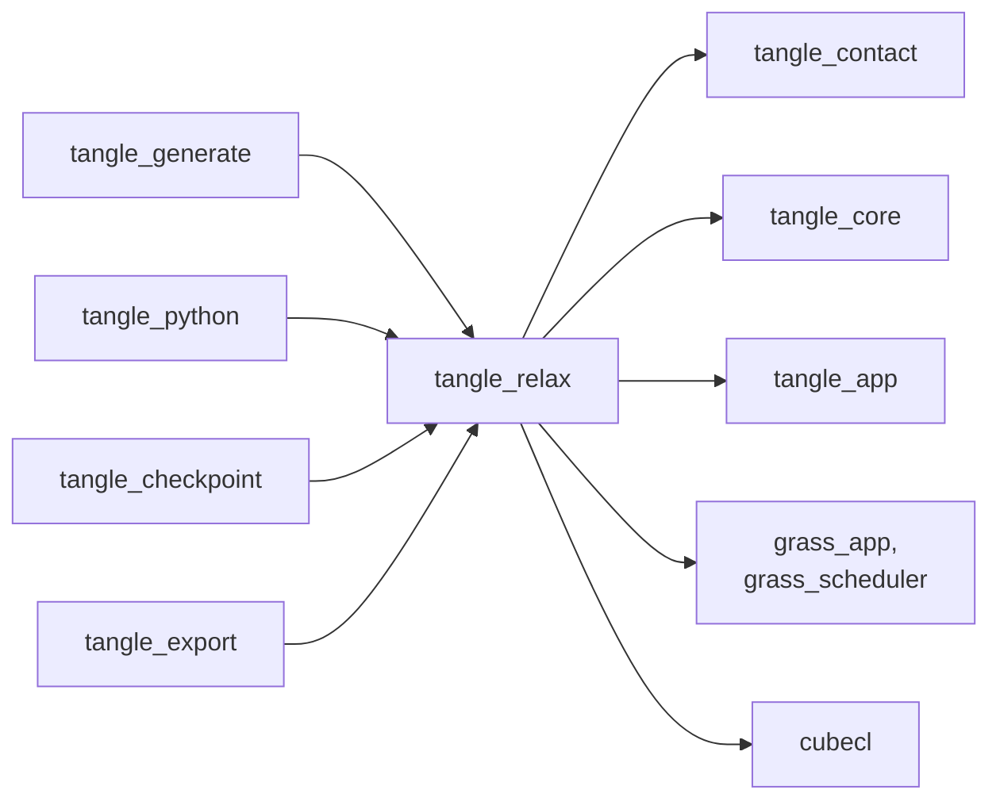
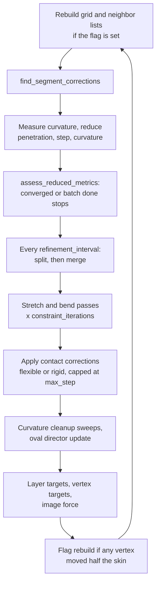

# tangle_relax

The solver of TANGLE: a device world that holds a packed fiber assembly in CubeCL buffers and relaxes it in bounded batches of position-based corrections for contact, stretch, bending, curvature limits, formation targets and an optional CT image force. It also holds the compaction and formation operations a recipe applies between batches, restart checkpoints, and `RelaxationPlugin`, the GRASS plugin that runs the solver inside a TANGLE app. tangle_generate drives it through recipes, tangle_python exposes it to Python, and tangle_checkpoint and tangle_export read its packed layout and state.

Part of [TANGLE](../../README.md). See [the architecture](../../docs/architecture.md) for how the crates fit together, [Oval fibers](../../docs/oval_fibers.md) for oval sections, and [CT fitting internals](../../docs/ct_fitting_internals.md) for how the image force is used in a fit.

## Contents

- [Where it fits](#where-it-fits)
- [What is in it](#what-is-in-it)
- [How it works](#how-it-works)
- [Using it](#using-it)
- [Tests](#tests)

## Where it fits



- [tangle_contact](../tangle_contact/README.md) gives it the grid, neighbor-list and contact kernels and `CellListConfig`, which this crate re-exports. This crate owns their buffers and applies the corrections they write.
- [tangle_core](../tangle_core/README.md) gives it `FiberAssembly`, sections, bend limits and the cell; `PackedAssembly` packs one and unpacks results back into it.
- [tangle_app](../tangle_app/README.md) gives it `TangleStage`, `TanglePhase` and the capability ids the plugin provides and requires. `grass_app` and `grass_scheduler` (the GRASS app framework, from git) give it `Plugin`, resources and systems.
- [tangle_generate](../tangle_generate/README.md) runs recipes on it: layer and needle targets, staged activation, compaction with `CompactionKinematics` and `CompactionMetrics`, and `capture_contacts` for junctions.
- [tangle_python](../tangle_python/README.md) builds `RelaxationConfig` from Python settings ([settings.rs](../tangle_python/src/settings.rs)), installs `RelaxationPlugin` for `Recipe.run` ([recipe.rs](../tangle_python/src/recipe.rs)), drives a `DeviceWorld` with an image directly in `ImageRelaxer` ([image.rs](../tangle_python/src/image.rs)), and exposes the compaction kinematics ([compaction.rs](../tangle_python/src/compaction.rs)).
- [tangle_checkpoint](../tangle_checkpoint/README.md) saves and restores `DeviceWorldCheckpoint` and `PackedAssembly`.
- [tangle_export](../tangle_export/README.md) writes trajectories from `RelaxationState` snapshots and uses `oval_lane_count` to draw oval lanes.

## What is in it

About 10,800 lines, tests included.

### The device world

| Module | What it does |
| --- | --- |
| [lib.rs](src/lib.rs) | the public re-exports |
| [device/mod.rs](src/device/mod.rs) | `RelaxationSnapshot` and `cube_grid`, which spreads a large launch over rows of cubes |
| [device/packed.rs](src/device/packed.rs) | `PackedAssembly` (the flat buffers uploaded to the device), `AdaptiveSegmentationConfig`, `PackingError`, oval lanes (`oval_lane_count`, `MAXIMUM_OVAL_LANES`, `OVAL_LANE_SPACING`) |
| [device/world.rs](src/device/world.rs) | `DeviceFiberWorld<R>`: upload and grid sizing, `run_batch`, adaptation epochs, formation targets, `compact_cell`, `compaction_metrics`, `capture_contacts`, `checkpoint` and `restore`, downloads; plus `BatchStatus`, `ContactCapture`, `DeviceWorldCheckpoint` |
| [device/world/cell_list.rs](src/device/world/cell_list.rs) | launching the grid build and the prefix scans |
| [device/world/neighbor_list.rs](src/device/world/neighbor_list.rs) | launching neighbor-list rebuilds and their requests; `neighbor_list_rebuilds` |
| [device/world/image_force.rs](src/device/world/image_force.rs) | `ImageForceSettings`, `set_image`, `set_image_force`, `image_vertex_stats`, and the image step of a batch |
| [device/world/pinning.rs](src/device/world/pinning.rs) | `set_vertex_pinned`, `pinned_vertex_count` |

### Kernels

| Module | What it does |
| --- | --- |
| [device/kernels.rs](src/device/kernels.rs) | batch control and metric reductions, internal (stretch and bend) corrections, curvature projection, flexible and rigid contact application, refinement and coarsening, formation and layer targets, compaction kinematics and metrics, oval director updates |
| [device/image_force.rs](src/device/image_force.rs) | `find_image_corrections` and `apply_image_corrections`: polar sampling of the image with the nearest-surface ownership rule |

### GRASS and compaction

| Module | What it does |
| --- | --- |
| [device/plugin.rs](src/device/plugin.rs) | `RelaxationPlugin`, `RelaxationConfig` and its builders, `RelaxationState`, `RelaxationOverrides`, `WorkflowControl`, `DeviceState`, `DeviceWorld` (one variant per backend), `RelaxationBackend`, `FiberMotion`, `ContactAggregation` |
| [compaction.rs](src/compaction.rs) | `CompactionKinematics`, `CompactionEnergyModel`, `CompactionMetrics` |
| [device/world_tests.rs](src/device/world_tests.rs) | tests of the device world |

## How it works

### Packing and upload

`PackedAssembly::from_assembly_with_options` checks the assembly, refuses a cell that is not orthorhombic, and lays it out as structure-of-arrays: interleaved xyz positions and intrinsic positions, two vertex ids per segment, owner fiber, radius, rest length, previous and next segment per vertex, rest chords, maximum curvature, active and pinned masks, fiber spans, formation layer and step, and the cell bounds and periodic flags. Ovals add a lane offset per segment and a long-axis director per vertex.

With `AdaptiveSegmentationConfig`, each input segment instead reserves a full binary tree of midpoint subdivisions, as deep as `maximum_refinement_levels` and the `minimum_length_over_diameter` limit allow. Only the roots and the original vertices start active; the rest is capacity that refinement switches on. Adaptive packing accepts only circular sections. Coarsening is marked unsafe when the assembly has junctions.

`DeviceFiberWorld::upload` sizes the grid from the packed layout. The cell width covers one proxy piece plus the interaction margin (two radii plus the larger of twice `max_step` and the skin), times `cell_size_scale`. Segments longer than one list block get proportionally more neighbor-list room and are binned as that many proxy pieces. The neighbor-list buffer is capped at 120 MiB (`MAXIMUM_NEIGHBOR_LIST_BYTES`), under WGPU's default binding limit; when the active blocks do not fit, the block size shrinks and more segments take the overflow scan.

### One iteration

`run_batch` launches `iterations + 1` passes without reading anything back until the end. Every kernel checks the device control word, so once the batch converges the remaining launches return at once. The last pass skips targets and the image force; it only measures, so the status reports the state after the final correction.



The contact corrections are found from the positions at the start of the iteration and applied after the stretch and bend passes. Flexible motion moves each vertex by the sum of its two segments' corrections, capped at `max_step` and clamped inside bounded walls; the clamped part is added to `wall_reactions`. Rigid translation moves each fiber by one vector, preserving its shape. The curvature cleanup then runs forward and backward Gauss-Seidel sweeps along each fiber in one thread per fiber, so neighboring bend constraints reinforce instead of cancel. Formation targets are applied last so each iteration ends at the commanded position, and the next contact pass resolves what they disturbed. The adaptation epoch and the stretch, bend and cleanup steps run only for flexible motion.

`assess_reduced_metrics` stops the batch when penetration is within `penetration_tolerance` and the largest curvature ratio within `1 + curvature_ratio_tolerance` (unless `force_full_iterations`), or when the batch has run its iterations. The control word holds the running flag, the lifetime and batch iteration counts, and an overflow latch.

### Neighbor-list rebuilds

A rebuild is pending at upload and whenever a vertex has moved more than half the skin (`neighbor_skin_scale` times the largest radius) since the last build, checked after every iteration and once at the start of each batch for moves made between batches. Operations that change geometry or activity outside the loop request one explicitly: an adaptation epoch that split or merged anything, `compact_cell`, `activate_formation_step`, `activate_refinement_vertices`, and `capture_contacts`, which overwrites the shared grid with its own layout. The flag lives on the device; [tangle_contact](../tangle_contact/README.md#neighbor-lists) describes the build itself.

### Adaptive refinement and coarsening

Every `refinement_interval` iterations of flexible motion, an adaptation epoch runs. `mark_refinement_candidates` counts, per active segment, consecutive epochs with penetration above the tolerance; a segment longer than `contact_length_over_diameter` diameters, whose halves stay above the minimum length, splits after `refinement_persistence` epochs. `apply_refinement_candidates` then activates its midpoint at the chord midpoint and its two children. Deciding and applying are separate launches so a child cannot split in the same epoch it was born.

Coarsening runs when `coarsening_persistence` is above zero, the layout is coarsening-safe and no vertex targets are held. `mark_coarsening_candidates` picks inactive parents whose two active children have stayed contact-free for that many epochs, whose midpoint is active, unpinned, within `coarsening_curvature_ratio` and within `coarsening_error_over_diameter` of the parent chord. `apply_coarsening_candidates` merges them. After the epoch the host compacts the active segment and vertex lists, which reads two counts back from the device. The cadence follows the lifetime iteration count, so results do not depend on where batch boundaries fall.

### Image force

`set_image` uploads a normalized CT volume, stored `(z, y, x)`, up to 120 MiB, for round fibers only. With a positive `rate`, each active, unpinned vertex samples the image on a polar grid of `rings` by `spokes` points in its cross-section, out to `reach_radii` radii with Gaussian weights of width `sigma_radii`. It keeps the samples nearer its own surface than any other fiber's (found through the neighbor lists) and moves laterally toward their weighted centroid. The polar table is built on the host, so no trigonometry runs on the device. `image_vertex_stats` measures each vertex's owned mass and support between batches.

### Compaction and formation hooks

These run between batches without downloading geometry:

| Call | What it does |
| --- | --- |
| `compact_cell` | shrinks the cell within its current bounds, moving fibers by `CompactionKinematics`: rigid fiber centers, moving walls, or affine vertices |
| `compaction_metrics`, `wall_face_pressures` | directional pressure from contact corrections and wall reactions, and contact, stretch and bending penalty energies under a `CompactionEnergyModel` |
| `apply_layer_targets`, `apply_single_layer_target` | pull labeled layers' fiber centers toward target coordinates each iteration, with a capped step |
| `apply_vertex_displacement_targets` | capture selected vertices' positions plus a displacement as persistent targets, for needling |
| `activate_formation_step`, `activate_refinement_vertices` | switch on prepacked fibers of a recipe step, or the subdivision paths to selected reserved vertices |
| `set_fiber_maximum_curvatures`, `set_vertex_pinned` | change curvature limits and pins in place |
| `capture_contacts` | list contacting segment pairs within a surface gap, for junction capture |
| `checkpoint`, `restore` | persistent state for restart; scratch broad-phase buffers are rebuilt by the first batch |

### The GRASS plugin

`RelaxationPlugin` checks its `RelaxationConfig`, adds the config, `RelaxationState`, `DeviceState`, `WorkflowControl` and `RelaxationOverrides` resources, and adds two systems that run in `TangleStage::Relax`: one uploads the assembly in `TanglePhase::PrepareGeometry`, the other runs one batch per update in `TanglePhase::ApplyConstraints`. Each batch takes at most `iterations_per_batch`, trimmed by `WorkflowControl` and by the debug snapshot interval, with `RelaxationOverrides` layered over the config. Positions are downloaded only for a snapshot or at the end. When the run converges (and `hold_relax_stage` is off), runs out of iterations or overflows, the plugin unpacks positions into the `FiberAssembly`, saves the assembled reference if converged, and moves to `next_stage`, or to `Done` without convergence. It provides `TANGLE_CONTACTS` and `TANGLE_RELAXATION` and requires `TANGLE_WORKFLOW` and `TANGLE_ASSEMBLY`.

### Backends and large launches

The `wgpu`, `cpu`, `cuda` and `hip` features each add a `RelaxationBackend` and `DeviceWorld` variant and forward to tangle_contact; `wgpu` and `cpu` are the defaults, and the default backend is the first enabled of WGPU, CPU, CUDA, HIP. WebGPU allows at most 65,535 workgroups per dimension, so `cube_grid` lays a launch out as one row while it fits and otherwise as more rows of at most 65,535 cubes. Kernels index by `ABSOLUTE_POS` and `CUBE_POS`, which run on from row to row, and skip units past their length.

### Invariants

- **Launch through `cube_grid`.** A launch sized as one row fails on WGPU past 65,535 cubes, and a kernel must tolerate the extra cubes of the last row.
- **Gate on the control word.** Every kernel in the iteration loop returns when `control[0]` is zero. A new kernel that skips the check keeps moving vertices after convergence.
- **Request a rebuild when geometry moves outside the loop.** Neighbor lists are trusted until the device flag is set; any new operation that moves vertices, changes the active set or reuses the grid buffers must call `request_neighbor_list_rebuild`.
- **Every change to the active set recompacts.** Call `rebuild_active_indices` after splits, merges or activation, since kernels launch over the compacted lists and neighbor-list offsets follow them.
- **Split and merge in two launches.** Marking reads only, applying writes only its own segment's tree nodes; merging them into one launch makes the result depend on scheduling.
- **Repeatability.** `relaxation_is_bitwise_repeatable` and its adaptive and proxy versions compare runs bit for bit. Keep atomic appends sorted before any float sum.
- **Adaptive layouts stay flexible and round.** The plugin asserts flexible motion with adaptive segmentation, packing refuses non-circular sections, and `set_image` refuses ovals.
- **Lane counts agree.** `oval_lane_count` matches the lane count computed in tangle_contact's contact kernel.

## Using it

Driving a world directly, as `ImageRelaxer` does:

```rust
use tangle_relax::{DeviceWorld, PackedAssembly, RelaxationConfig};

let config = RelaxationConfig::flexible().with_penetration_tolerance(1.0e-4);
let packed = PackedAssembly::from_assembly(&assembly)?;
let mut world = DeviceWorld::new(&config, packed);
loop {
    let status = world.run_batch(&config, config.iterations_per_batch);
    if status.converged || status.total_iterations >= config.max_iterations {
        break;
    }
}
let positions = world.download_positions();
world.unpack_positions(&positions, &mut assembly)?;
```

Inside a TANGLE app, add the plugin and read `RelaxationState` afterwards:

```rust
app.add_plugins(RelaxationPlugin { config: RelaxationConfig::flexible() });
```

| Entry point | Use |
| --- | --- |
| `RelaxationPlugin`, `RelaxationConfig` | relaxation as a stage of a GRASS app |
| `DeviceWorld::new`, `restore`, `run_batch` | a world on the configured backend, driven by hand |
| `DeviceFiberWorld::<R>::upload` | a world on one CubeCL runtime |
| `PackedAssembly::from_assembly_with_options` | packing with adaptive capacity or pinned ends |
| `RelaxationOverrides`, `WorkflowControl` | per-operation settings and batch control for recipes |
| `compact_cell`, `compaction_metrics` | compaction steps |
| `set_image`, `set_image_force` | CT image attraction |
| `capture_contacts` | contacts for junction capture |

## Tests

The default features include WGPU, which needs a GPU adapter. To test on the CPU runtime only:

```sh
cargo test -p tangle_relax --no-default-features --features cpu
```

| Where | What |
| --- | --- |
| [device/world_tests.rs](src/device/world_tests.rs) | relaxation, staged activation, refinement and coarsening rules, self-contact, pinning, curvature limits and cleanup, layer and vertex targets, rigid motion, compaction, periodic contact, neighbor lists and proxy pieces, ovals, bitwise repeatability; runs on WGPU, or on CPU without the `wgpu` feature |
| [device/world/image_force.rs](src/device/world/image_force.rs) | the image force on synthetic tube images: convergence onto a tube, zero rate, pinned fibers, neighbors keeping their own tube; needs `cpu` |
| [device/packed.rs](src/device/packed.rs) | packing formation layers, midpoint trees, oval lanes and director unpacking |
| [device/mod.rs](src/device/mod.rs) | `cube_grid` row spreading |
