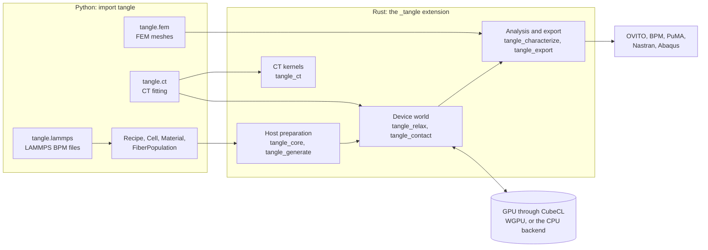
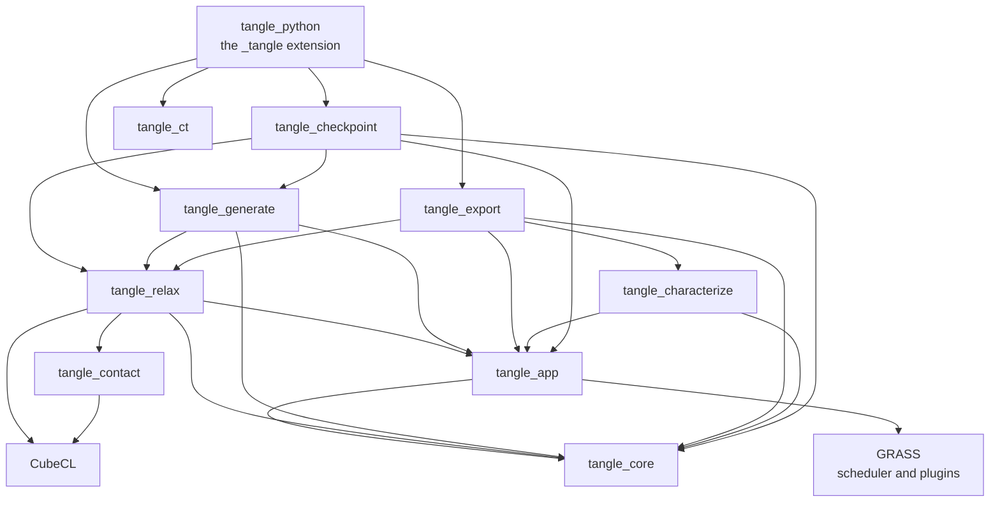
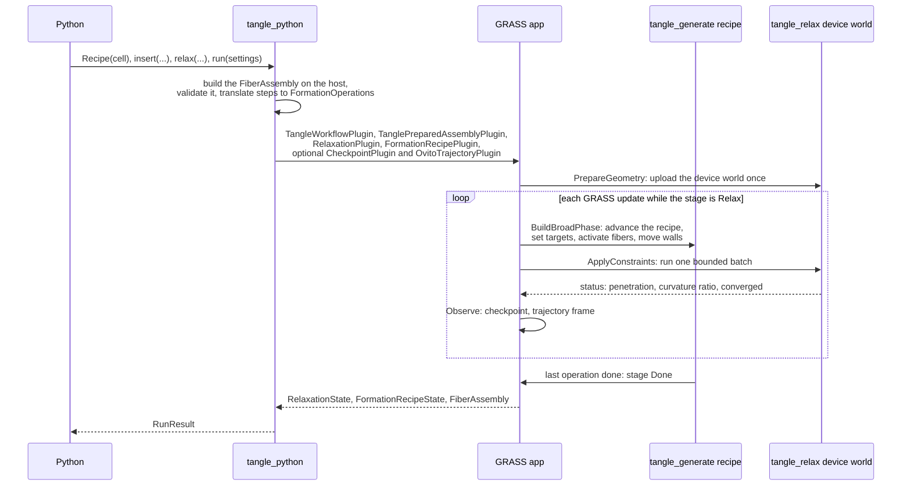
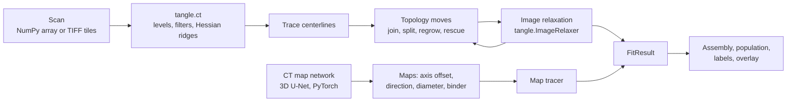

# Architecture

How TANGLE is put together: what ships, the crates it is built from, how a recipe runs on the GPU, how a CT fit travels through the code, and what the solver does and does not promise. Read this first if you want to change the code. Each crate has its own README with the detail; this page is the map.

For normal use, begin with the [Python guide](../crates/tangle_python/README.md).

- [The big picture](#the-big-picture)
- [What ships](#what-ships)
- [The crates](#the-crates)
- [Life of a recipe run](#life-of-a-recipe-run)
- [Life of a CT fit](#life-of-a-ct-fit)
- [Outputs](#outputs)
- [Solver notes](#solver-notes)
- [Design rules](#design-rules)
- [Where to start reading](#where-to-start-reading)

## The big picture

A person writes a **recipe** in Python: a cell, the fiber materials and populations to insert, and the manufacturing steps to apply (relax, place layers, needle, compact, capture junctions). Python hands the recipe to Rust, which prepares the fibers on the host, uploads them once to a **device world** on the GPU, and runs the recipe as bounded batches of relaxation iterations. The relaxed assembly comes back to Python for analysis and export.

Three ideas shape the design:

- **Python is the front end, Rust is the only implementation.** Python builds collections and recipes and drives CT fitting. Validation, geometry, relaxation, characterization and file formats are public Rust APIs that Python calls; Python has no separate numerical implementation of the solver.
- **The geometry stays on the device.** A recipe uploads the fibers once. Recipe steps change targets, activate dormant fibers and move the cell walls between batches without uploading the geometry again, and a normal batch reads back only a few status numbers.
- **Relaxation is geometric, not dynamic.** A recipe is an ordered approximation of a manufacturing process, solved by iterative constraint projection. Its iteration count is not physical time, and a converged result means "no overlaps and no fiber bent past its limit", not mechanical equilibrium. See [Solver notes](#solver-notes).

## What ships

| What | Built from | Runs where |
| --- | --- | --- |
| The `tangle` Python package | [tangle_python](../crates/tangle_python/README.md): the `_tangle` PyO3 extension plus pure-Python `tangle.ct`, `tangle.fem`, `tangle.lammps` and `tangle.units` | Built from source with `maturin develop`; macOS, Linux and Windows |
| The Rust crates | `crates/*` | Linked by the extension, and usable directly from Rust |
| Native examples | [`examples/`](../examples/README.md), one Cargo package each, sharing [tangle_example_support](../examples/tangle_example_support) | `cargo run --release -p <example>` |
| Tutorials and Python examples | [`crates/tangle_python/python/tutorials`](../crates/tangle_python/python/tutorials) and [`python/examples`](../crates/tangle_python/python/examples) | Jupyter or plain Python, once the package is installed |
| Guides | [`docs/`](README.md) | Read on GitHub |

The workspace lists its members by name in [Cargo.toml](../Cargo.toml), so output folders an example writes under `examples/` never become part of the build.

## The crates

`tangle_python` links every crate except `tangle_contact`, which it reaches through `tangle_relax`. `tangle_core`, `tangle_contact` and `tangle_ct` depend on no other workspace crate: `tangle_contact` and `tangle_ct` can be read on their own.

| Crate | What it is |
| --- | --- |
| [tangle_core](../crates/tangle_core/README.md) | The canonical `FiberAssembly`: fibers, rest and placed centerlines, materials and sections, the periodic cell, junctions, provenance, and validation |
| [tangle_app](../crates/tangle_app/README.md) | The GRASS workflow: `TangleStage`, `TanglePhase`, capability ids, and the plugins that install an assembly |
| [tangle_generate](../crates/tangle_generate/README.md) | Seeded generators (crossings, populations, layers, multisegment fibers) and the formation recipe engine: insertion, layer moves, needling, compaction control, junction capture |
| [tangle_contact](../crates/tangle_contact/README.md) | CubeCL kernels for the cell list, Verlet neighbor lists and exact capsule contacts |
| [tangle_relax](../crates/tangle_relax/README.md) | The persistent device world and its relaxation kernels: contact, stretch, bending, bend limits, walls, adaptive refinement, image forces, and the `RelaxationPlugin` |
| [tangle_checkpoint](../crates/tangle_checkpoint/README.md) | Atomic checkpoints of a running recipe and resume |
| [tangle_characterize](../crates/tangle_characterize/README.md) | Native measurements: lengths, volume fractions, orientation, curvature and shape, contacts and neighbors |
| [tangle_export](../crates/tangle_export/README.md) | OVITO dumps and trajectories, bonded-particle (BPM) export, the PuMA bundle, and the voxel labels behind `tangle.fem` |
| [tangle_ct](../crates/tangle_ct/README.md) | The volume kernels behind `tangle.ct`: filters, Hessians, tracing, topology moves, rendering, confidence |
| [tangle_python](../crates/tangle_python/README.md) | The Python package: PyO3 bindings and the pure-Python modules |

## Life of a recipe run

- **Preparation.** `Recipe.insert` generates each population on the host with a fixed seed and records the step at which it becomes active. Inserted fibers are packed into the device world but stay dormant, and take no part in contacts, until an `ActivateFibersThrough` step reaches them. `Recipe.run` validates the assembly, checks material names, and calls `run_native_recipe` in [recipe.rs](../crates/tangle_python/src/recipe.rs) with the Python thread released. A recipe that only inserts fibers gets a final relax-until-converged step.
- **One GRASS update.** `TanglePhase` orders the systems inside each update: `Generate`, `PrepareGeometry`, `BuildBroadPhase`, `DetectContacts`, `ApplyConstraints`, `UpdateGeometry`, `Observe`, `MeasureConvergence`, `FormJunctions`, `Export`, `Transition`, `Stop`. `TangleStage` decides which systems are active. A Python recipe starts in `Relax` and stays there until the recipe controller sets `Done`. Some phases (`DetectContacts`, `UpdateGeometry`, `MeasureConvergence`, `FormJunctions`) and stages (`FormJunctions`, `Characterize`, `Ready`, `Deform`) are declared for plugins but no built-in plugin uses them yet: contact detection runs inside the relaxation batch, and the recipe captures junctions itself.
- **Batches.** The device runs at most `iterations_per_batch` iterations per update (128 by default). The recipe controller can cap the next batch through `WorkflowControl`, and a debug snapshot interval shortens a batch so a frame lands on time. Between batches only scalar status is read back.
- **Operations.** `FormationOperation` in [recipe.rs](../crates/tangle_generate/src/recipe.rs) lists every step a recipe can take: activate fibers, set a material's bend radius, relax for a count or until converged or under a `SolvePolicy`, place or move layers, needle a layer and release the needles, fit the cell to the fibers, compact toward a target, and capture junctions once or at a cadence.
- **The result.** The app returns `RelaxationState` (iterations, converged, largest penetration and curvature ratio, adaptive counts, bytes moved), the recipe's events and warnings, and the final `FiberAssembly`, which becomes the Python `RunResult`. A failed operation becomes a `RecipeError` naming the operation and the iteration.

The [tangle_relax README](../crates/tangle_relax/README.md) follows one iteration inside the device world, and the [tangle_generate README](../crates/tangle_generate/README.md) covers each operation.

## Life of a CT fit

`tangle.ct` is Python orchestration over Rust. The heavy volume work (Gaussian filters, sampling, distance transforms, tracing, overlap, resampling, fragment merging, grey rendering, projection) runs in [tangle_ct](../crates/tangle_ct/README.md) through the `ct_*` functions in [ct.rs](../crates/tangle_python/src/ct.rs), wrapped for NumPy in `tangle/ct/_native.py`. Pulling fibers toward the image while they keep their diameter, bending and non-overlap runs on the device world through `tangle.ImageRelaxer` ([image.rs](../crates/tangle_python/src/image.rs) over `tangle_relax`'s image force). `fit_tiled` splits a whole scan into tiles and saves each as it finishes, so a stopped run resumes.

The map network path (`ct.find_fibers`) replaces the grey tracer with a trained 3D U-Net. It needs PyTorch, and lives in `tangle/ct/_network`. Synthetic scans for training and testing come from `ct.synthetic_ct` with a `ct.Scanner`, which scans a known Tangle structure the way a micro-CT does.

See the [CT fitting guide](ct_fitting.md), [the method step by step](ct_fitting_internals.md), [synthetic CT](ct_synthetic.md) and the [CT map network](ct_unet.md).

## Outputs

| Output | Where it is written | Guide |
| --- | --- | --- |
| OVITO dump of the final geometry, or a multi-frame trajectory | [tangle_export](../crates/tangle_export/README.md) `ovito.rs`, `trajectory.rs` | [Results tutorial](../crates/tangle_python/python/tutorials/14_results_and_exports.ipynb) |
| Bonded-particle model (spheres or spherocylinders, with bonds) | `tangle_export` `bpm.rs`, `bridges.rs` | [Fiber bonds](fiber_bonds.md) |
| LAMMPS BPM data files read, relaxed and written back | `tangle/lammps.py`, which relaxes through a normal recipe | [LAMMPS BPM](lammps_bpm.md) |
| PuMA VTI/JSON bundle | `tangle_export` `puma.rs` | [PuMA interoperability](puma_interoperability.md) |
| Nastran and Abaqus meshes | `tangle/fem`, on the voxel labels from `tangle_export` (hexahedra) or gmsh (tetrahedra) | [FEM export](fem_export.md) |
| Analysis reports | [tangle_characterize](../crates/tangle_characterize/README.md) | [Python guide](../crates/tangle_python/README.md#native-analysis-and-puma-export) |
| Checkpoints | [tangle_checkpoint](../crates/tangle_checkpoint/README.md) | Below |

## Solver notes

### Data and scheduling

`FiberAssembly` holds intrinsic (rest), placed, and optional assembled-reference centerlines, material/section tables, periodic cell, provenance, and junctions. Material-coordinate `FiberAnchor`s resolve onto the current discretization.

Collections are prepared on the host, packed into the device world, and activated at their scheduled insertion steps. Dormant fibers do not participate in contacts. GRASS schedules bounded batches and operation transitions; it can change layer targets, activate populations, and compact the cell between batches without re-uploading all geometry. The stack axis (the direction layers stack along) comes from the cell: z when z is bounded or every axis is periodic, otherwise the last bounded axis. `Recipe(cell, stack_axis="x")` overrides it.

### Quasi-static relaxation, not a dynamics solver

The current method iteratively applies capsule-contact separation, stretch constraints, rest-chord bending corrections, boundary corrections, and a three-point admissible-curvature projection. It is a constraint/penalty-based geometric relaxation, not a proof of a global energy minimum or a calibrated force–displacement solver. Formation penalty energies and directional pressure proxies help control compaction; they are not automatically physical stresses.

Rigid mode translates every vertex of a fiber together. Flexible mode lets vertices move independently subject to stretch, rest-shape, and bend-limit constraints. Pinned vertices have zero inverse mass in curvature projection. Natural curvature and admissible curvature are distinct: the first is a preference, the second limits allowed bending.

Hard acceptance requires both penetration and bend utilization to meet their configured tolerances. Recipes may use softer intermediate gates and temporary overrides. Inspect final residuals and events; reaching an iteration budget or passing a soft stage is not final mechanical acceptance.

### Device world and adaptation

CubeCL kernels run via WGPU or the explicit native CPU backend. A compact count/scan/scatter cell list builds per-segment Verlet neighbor lists holding every capsule within a skin of touching; exact capsule checks resolve contacts from those lists. Lists are rebuilt on the device once any vertex has moved half the skin (`CellListConfig::neighbor_skin_scale`, a multiple of the largest radius), or after activation, refinement, or compaction changes the geometry. Orthorhombic periodic axes use wrapped neighborhoods/minimum-image contacts; bounded axes have planar walls. Normal batches read scalar status; debug trajectories and checkpoints explicitly read geometry.

Adaptive centerlines reserve dyadic trees and alter activity masks. Persistent contact triggers refinement; quiet, sufficiently straight siblings can coarsen. Pinned, targeted, strongly bent, and junction-bearing topology is protected. Refinement/coarsening cadence uses solver iterations independently of GRASS batch size. Reserved memory and inactive-node work mean fewer active segments do not guarantee proportional speedups.

### Compaction and junctions

Compaction moves the cell incrementally, relaxes, and accepts or rolls back a trial. Targets include nominal volume fraction, dimensions, and penalty-based pressure/energy measures. Axis selection and opposing-face balancing can adapt to relaxation cost. A jam or exhausted guard is a reported outcome, not a license to export a penetrated trial as converged.

Junction capture filters contact candidates by material pair, gap, angle, probability, multiplicity, and anchor spacing. Captured junctions become persistent topology and can be exported as inter-fiber bonds. **They currently do not enforce mechanical bonding during subsequent TANGLE relaxation.** Ordinary contacts are neither permanent bonds nor junctions. Late capture is appropriate when bonds represent binder added after formation.

### Reproducibility and restart

Seeded geometry generation is deterministic. Relaxation sorts what its atomic scatters write (cell slots are ranked, neighbor lists sorted) so that float sums run in a fixed order, and tests in `tangle_relax` check that repeated runs on one backend match bit for bit. Results are not promised identical across devices, backends or revisions: compare geometry and residuals within explicit tolerances.

Atomic checkpoints contain assembly, recipe cursor/partial operation, counters, active topology, adaptive history, cell bounds, and manufacturing targets. Scratch contact data is rebuilt on resume. Checkpoint schemas are experimental; cross-revision compatibility is not guaranteed. Archive the generating revision, settings, backend, and a final geometry export, and branch output paths when trying a new cleanup strategy.

## Design rules

| Rule | Why |
| --- | --- |
| Geometry types live in `tangle_core`; algorithms stay ordinary functions in the crate that owns them, installed into the workflow by a GRASS plugin | Any crate can use the geometry without pulling in the GPU, and a plugin can be swapped without touching the rest |
| A backend is chosen explicitly (`backend="wgpu"` or `"cpu"`, and `"cuda"` in a build with the `cuda` feature), with no silent CPU fallback | A run that was meant for a GPU should fail loudly rather than run for hours on the CPU |
| Upload once, change targets between batches, read back only status | Host and device traffic is what makes a large recipe slow |
| Contacts are not junctions, and junctions are not enforced while relaxing | Junctions are topology for export; treating them as bonds during relaxation would claim mechanics the solver does not do |
| Converged means both penetration and bend utilization within tolerance | A soft gate or a spent iteration budget is not a relaxed specimen |
| Python adds no numerics of its own to the solver | One implementation to test, and Rust users get the same results |
| Settings left unset scale with the fiber diameter | A recipe written for 10 µm fibers behaves the same for 30 µm fibers |

## Where to start reading

- **A recipe end to end:** `PyRecipe::run` and `run_native_recipe` in [recipe.rs](../crates/tangle_python/src/recipe.rs), then `FormationRecipePlugin` in [tangle_generate's recipe.rs](../crates/tangle_generate/src/recipe.rs).
- **One relaxation iteration:** `run_device_batch` in [plugin.rs](../crates/tangle_relax/src/device/plugin.rs), then `run_batch` in [world.rs](../crates/tangle_relax/src/device/world.rs) and the kernels in [kernels.rs](../crates/tangle_relax/src/device/kernels.rs).
- **How contacts are found:** [tangle_contact](../crates/tangle_contact/README.md).
- **The data model:** [assembly.rs](../crates/tangle_core/src/assembly.rs) and [validation.rs](../crates/tangle_core/src/validation.rs).
- **A CT fit:** `fit_fibers` in [`tangle/ct/_fit.py`](../crates/tangle_python/python/tangle/ct/_fit.py), then [tangle_ct](../crates/tangle_ct/README.md).
- **Every Python name:** [`_tangle.pyi`](../crates/tangle_python/python/tangle/_tangle.pyi), the type stub for the extension.
